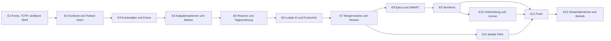

> Historische Planungsgrundlage vom 14. Oktober 2026. E1.1-Auftrag und aktuelle ADRs gelten vorrangig; siehe [Architekturübersicht](README.md). Persönliche lokale Verweise wurden entfernt.

# Helios 2.0 - Implementierungsplan fuer die neue Codebasis

Stand: 14. Oktober 2026. Ausschliesslich Planung; alle Etappen sind noch nicht begonnen.

## 1. Ziel, Umfang und Quellen

Variante C ist verbindlich. Neue Anwendung/neue lokale PostgreSQL-Datenbank, keine Helios-1.0-Datenuebernahme und keine API-Parallelkompatibilitaet. Bestehende Todoist-Inhalte bleiben bei Projektaufbau/Ersteinrichtung unveraendert; spaetere fachlich erlaubte Writes sind bewusste bzw. eng definierte Systemoperationen. Kein altes Verzeichnis/Compose/Schema wird ueberschrieben.

Empfohlener Stack: Next.js/React/TypeScript, frameworkfreie Backendmodule, PostgreSQL/Drizzle, separater Node-Worker/pg-boss, Better Auth mit Argon2id und verpflichtendem TOTP, lokale Ollama-Use-Cases. Technische Vertrage/Modelle in [Zielarchitektur](helios-technical-architecture.md), noch offene Policy-/Umgebungsentscheidungen in [offene Entscheidungen](helios-open-decisions.md).

Fachlich verbindlich: [79-Anforderungen-Lastenheft](https://app.notion.com/p/3f77667a045981c0b688c82885b82ca1), Freigabe/F1-F5/Mobile, [ADR-001 bis ADR-004](https://app.notion.com/p/3f87667a04598161aae9f9f5550b59cf) und [Sites-Design V2](https://helios-2-prototyp.greenbream.chatgpt.site). Alte Evaluation ist technische Fehler-/Designreferenz, ihre Variante-B-/Migrationsstrategie ist ueberholt. Live-Prototypinteraktionen bleiben ungeprueft; mobile Layoutreferenz noch festzulegen.

**Fruehe Pilotversion:** nach E3 anmelden, eigene Kontexte waehlen, echte Tasklesesicht und getrennte bestaetigte Tagesplaene mit Fokus nutzen. Nach E5 erweitert um komplette Aufgabenaktionen, Reserve und persistente Ordnung. Noch keine Behauptung vollstaendiger 2.0-Erfuellung. Die erste vollstaendige Lieferung umfasst Lernen, mobile Routine und Push sowie alle verbindlichen Abnahmen; diese werden nicht als optionales Spaeter aus dem Auftrag entfernt.

Keine feste Zeit-/Kosten-/Termincommitment ohne Zielhardware/Integrationsvertraege. Jede Etappe kann in wenige unabhaengig reviewbare PRs zerlegt werden; jeder PR soll einen funktionierenden, testbaren Teil des benannten Ablaufs erhalten.

## 2. Abhaengigkeiten und gemeinsame Fertigkriterien

E11 kann nach bestaetigter mobiler Gestaltung auf E7 aufbauen, waehrend E8-E10 weitergehen. Kein zweites Backend/Projekt. E12 benoetigt den Workerzeitvertrag und TermiHub-Startdaten; Grundzugang zur Routine wartet nie auf abgeschlossene Nacht-KI.

Gemeinsame Fertigkriterien jeder Etappe: UI-/API-/Persistenzablaeufe zusammen demonstrierbar; erwartete Revision/Scope serverseitig geprueft; definierte Leer/Lade/Fehler-/Teilerfolgszustaende; Originaleingaben bei Fehler erhalten; keine Secrets in Client/Logs; relevante automatisierte Tests/Build/CI bestanden; fachliche Referenzen im PR benannt. Sicherheits- und Integrationsfaehigkeiten entstehen beim ersten betroffenen Ablauf, nicht erst in einer abschliessenden grossen Haertungsphase.

## 3. Vertikale Etappen

### E1 - Neues Projekt mit sichtbarer Authentifizierung

| Feld                 | Geplanter Umfang                                                                                                                                                                                                                                                                            |
| -------------------- | ------------------------------------------------------------------------------------------------------------------------------------------------------------------------------------------------------------------------------------------------------------------------------------------- |
| Ziel                 | Neue sichtbare Anwendung mit sicherer lokaler Kontoeinrichtung und echter Passwort+TOTP-Anmeldung.                                                                                                                                                                                          |
| Funktionen           | Neues Repo/Workspace, Web/Worker/DB-Grundgeruest, Setup-only-UI, TOTP-QR/Pruefung/Recovery, Login/Logout, geschuetzte Desktop-/Mobilshell und Sicherheitseinstellungen. Noch keine echten Todoist-Inhalte.                                                                                  |
| Voraussetzungen      | Implementierungsfreigabe, O-01 Repository, O-03 Fristen, O-15 Origins; sichere lokale Entwicklungs-/Testumgebung.                                                                                                                                                                           |
| Module               | identity, Authadapter/Drizzle-Schema, Weblayouts, shared contracts, minimaler Worker, CI/Compose fuer neue App.                                                                                                                                                                             |
| Risiken              | Pluginendpoint umgeht Pflicht-TOTP, endloses Trust-Sliding, Bootstraprennen, Code-Replay, Linux-native Argon2-/Versionsprobleme.                                                                                                                                                            |
| Automatisierte Tests | Kein Signup/zweites Konto, direkter Fachzugriff ohne MFA denied, falscher TOTP/abgelaufene Challenge, doppelter Recoveryverbrauch, Widerruf/Absolutlimit trotz Refresh, Step-up, CSRF/Origin/Proxyheader, Argon2hash und Queue/Domaintransaktion. Browser-E2E fuer Enrollment/Login/Logout. |
| Abnahme              | Ohne gueltigen zweiten Faktor kein Fachzugriff; keine Defaultcredentials; Setupnachweis einmalig; vertrauenswuerdig <=30 Tage hart, andere Frist verkuerzt. Recovery/Secretrotation hat keinen offenen Zugriffszwischenzustand.                                                             |
| Demonstration        | Neue Helios-Shell oeffnen, Konto einrichten, Authenticator scannen, einloggen, fremde/abgelaufene Sitzung ablehnen und widerrufen.                                                                                                                                                          |

### E2 - Kontextsettings und lesende Todoist-Kopplung

| Feld                 | Geplanter Umfang                                                                                                                                                                                                                  |
| -------------------- | --------------------------------------------------------------------------------------------------------------------------------------------------------------------------------------------------------------------------------- |
| Ziel                 | Beliebige Arbeitgeber und Privat bewusst mit bestehenden Projekten verbinden.                                                                                                                                                     |
| Funktionen           | Instanz/Token geschuetzt speichern, lesender Verbindungstest/Projektkatalog, Name/Theme/Projekt/TermiHub-Mapping, Deaktivierung, Taskdetail/Basisliste mit Aktualitaet. Keine automatische Cloudumorganisation.                   |
| Voraussetzungen      | E1; Todoist-Testaccount/-projekte separat, O-02 TermiHub-Quelle einsammeln.                                                                                                                                                       |
| Module               | contexts, integrations, tasks/read projection, settings UI, problems, Verbindungstestjobs.                                                                                                                                        |
| Risiken              | Doppelmapping, Konto-/Projektwechsel, Inboxnamensheuristik, Label-/Sectionwrites schon beim Erstimport.                                                                                                                           |
| Automatisierte Tests | Genau ein Privat/ein Projekt je aktiver Kontext, Projektunique, frei benannte Kontexte, Deaktivierung stoppt Jobs/erhaelt Historie, Projektkatalog-Paging, Credentialredaktion; erstes Sync mit Fakeassertion keine Writeaufrufe. |
| Abnahme              | Alle Kontexte ueber Settings, IDs aus API; bekannte Todoist-Inhalte bleiben unveraendert. Projektzuordnung/Verbindungstest nur lesend/lokal. Tests der spaeter noetigen nativen Vertrage separat am Testaccount dokumentiert.     |
| Demonstration        | Drei frei benannte Arbeitgeber und Privat konfigurieren, Farben wechseln, Projekt/Tasks laden, einen Arbeitgeber deaktivieren; Cloudbestand dabei nicht umbauen.                                                                  |

### E3 - Persistenter Kontextplan und Fokus als Pilot

| Feld                 | Geplanter Umfang                                                                                                                                                                                             |
| -------------------- | ------------------------------------------------------------------------------------------------------------------------------------------------------------------------------------------------------------ |
| Ziel                 | Frueh tatsaechlich nutzbare Tagesauswahl/Fokus je Kontext.                                                                                                                                                   |
| Funktionen           | Manuelle/kleine deterministische Hauptauswahl, Kontext+Tag+Revision, Bestaetigung, Nachweis Abschnittsschritte, Fokuswahl/Heute-im-Blick, Reload/Historie, Basisbeobachtungen/Operationsstatus.              |
| Voraussetzungen      | E2, Todoist-G2-Vertrag fuer Sections/Move/Close; O-10 Backupminimum vor echten lokalen Plandaten. Fehlende benoetigte Sections nur bewusst separat einrichten.                                               |
| Module               | planning/focus, operations/jobs, observations, Desktopfokus/Planseite, serverseitige Guards.                                                                                                                 |
| Risiken              | Hauptauswahl ersetzt anderen Kontext, partielle Abschnittswechsel als Erfolg, Direktwahl veraendert Tagesordnung, KI-Abhaengigkeit.                                                                          |
| Automatisierte Tests | Kontext/Datumunique, Optimistic Locking zweier Geraete, Bestaetigungsrevision, Scopechecks, Idempotencykey mit anderem Body rejected, Teilerfolge/Retry, Fokus ohne Reorder, gespeicherter Plan ohne Ollama. |
| Abnahme              | F5; drei bis fuenf oder kleinerer geeigneter Bestand, getrennte Plaene/Fokus nach Reload; ausgewahlter aktiver Bestand korrekt In Arbeit, Vorschau != bestaetigt. Alte bestaetigte Revision nachvollziehbar. |
| Demonstration        | Zwei Arbeitgeber/Privat am selben Tag bestaetigen, Fokus wechseln, Browser reloaden, gleiche Plaene sehen; keine automatisierte Umplanung.                                                                   |

### E4 - Aufgabenverwaltung, Formular und Wartestatus

| Feld                 | Geplanter Umfang                                                                                                                                                                                                                     |
| -------------------- | ------------------------------------------------------------------------------------------------------------------------------------------------------------------------------------------------------------------------------------ |
| Ziel                 | Voller grundlegender Arbeitsablauf ohne KI.                                                                                                                                                                                          |
| Funktionen           | Filterbare Uebersicht/Details, Erfassen/Bearbeiten/Verschieben/Loeschen/Abschluss, Datum/Uhrzeit/Deadline, `fun` nur Privat, Kommentare, Wartedetails/Nachfassen und Kandidatenausschluss. Fester Erfassungsbutton/Formular nach V2. |
| Voraussetzungen      | E3/Operationsjournal, G2-Vertraege, O-09 Wartedetails.                                                                                                                                                                               |
| Module               | tasks, inbox read, operations, markdown basics, waiting, UI-Formulare/Dialoge.                                                                                                                                                       |
| Risiken              | Wiederholungsinstanz doppelt abgeschlossen, Update statt Move, Nebeninhalt verloren, privates Fun auf Arbeit, Delete unklar.                                                                                                         |
| Automatisierte Tests | Minimalcreate ohne Projekt -> Eingang ohne Analyse, Datenfeldclearing, getrennte Deadline, native Comments/Paging, Waitingfilter, direkte Delete-/Close-Kommandos, Recurrencetimeout unknown, Formularinput bei Fehler unveraendert. |
| Abnahme              | AT-07/08/10; Daten erst nach bestaetigtem externem Ergebnis gespeichert. Destruktive Aktion erkennbar, keine Deadlineerfindung, Routine/Plan ohne KI weiter nutzbar.                                                                 |
| Demonstration        | Aufgabe minimal erfassen, bearbeiten/kommentieren, Wartedetails setzen, Ausfall/Teilerfolg sehen, konkreten bestaetigten Abschluss ausfuehren.                                                                                       |

### E5 - Tagesordnung, manuelle Aufnahme und Reserve

| Feld                 | Geplanter Umfang                                                                                                                                                                          |
| -------------------- | ----------------------------------------------------------------------------------------------------------------------------------------------------------------------------------------- |
| Ziel                 | Bestaetigte reduzierte Fokus-/Reservebedienung statt kompletter Backlogansicht.                                                                                                           |
| Funktionen           | Persistentes Reorder von Haupt/Reserve, Drag-and-drop/Pfeile, direkte Fokuswahl, kuratierter zyklischer Stapel, Skipgrund optional, manuelles Hinzufuegen/Rueckweg und Einzelkartenpause. |
| Voraussetzungen      | E3/E4; klare Haupt-/Reservepositionen und Instanzreferenzen.                                                                                                                              |
| Module               | planning/reserve/focus, taskfilter, Observationevents, Tagesplan-/Fokus-UI.                                                                                                               |
| Risiken              | Positionsrennen, Einzelkartenendlosschleife, Skip als dauerhafte Abwertung, neue dringende Task plant automatisch um.                                                                     |
| Automatisierte Tests | F3/F4/F5, Rotation ueber mehrere Karten/Reload, Einzelkarte pausiert, zwei Reorder-Writes mit Konflikt, neue Task aendert Plan nicht, Direktwahl behaelt Ordnung, Tastaturalternative.    |
| Abnahme              | AT-06; nur eine Reservekarte sichtbar, Skip ans Ende/Erledigen entfernt, aktuelle Reihenfolge bis bewusster Aenderung stabil. Manuelle Aufnahme kontextgesichert.                         |
| Demonstration        | Haupt/Reserve sortieren, mehrere Reservekarten umlaufen lassen, eine einzige Karte pausieren, neue dringende Task bewusst aufnehmen.                                                      |

### E6 - Lokale KI-Entwuerfe und gemeinsamer Fortschritt

| Feld                 | Geplanter Umfang                                                                                                                                                                                                                                         |
| -------------------- | -------------------------------------------------------------------------------------------------------------------------------------------------------------------------------------------------------------------------------------------------------- |
| Ziel                 | Lokale KI liefert pruefbare Hilfe, keine autonomen Inhalte.                                                                                                                                                                                              |
| Funktionen           | Bewusste Text-Erfassung -> Vorschau -> Anlage, automatische managed-only-Analyse/Klaerung, Ist klar, Freitextfortschritt mit Einzelkommentar/Checkliste/Restaufwand, Verlustarmes Checklistgeruest.                                                      |
| Voraussetzungen      | E4/E5, O-11 Draftpolicy, O-12 Modelle, Worker/Entwurfs-/Patchvertrag. Automationen erst im freigegebenen verwalteten Kontext aktivieren.                                                                                                                 |
| Module               | ai, drafts, task_analysis, operations, markdown, shared progress/intake UI, problems.                                                                                                                                                                    |
| Risiken              | Eingang/fremde Projekte analysiert, Cross-Employerprompt, unbestaetigte Patches, Doppelcomment/Kinder, verlorener Freitext.                                                                                                                              |
| Automatisierte Tests | Projektguard an Enqueue/Claim, Prompt-/Schemafixture, invalid JSON/semantic patch, Quellenwechsel stale, Nutzerfelder/Einzelwahl, Originalinput bis Erfolg, duplikatfreie Teilergebnis-Wiederaufnahme, TOTP-authguard bei KIroute, Klarheitsfingerprint. |
| Abnahme              | AT-01/02/03/11 im jeweiligen Scope; Eingang unanalysiert, `need_context` nur echter Grund, veraltetes Planungsdatum getrennt und planbar. Analyse allein schreibt keine Inhalte.                                                                         |
| Demonstration        | Freitextentwurf bearbeiten/teilweise ablehnen, Zwischenstand dokumentieren, Speicherfehler ohne Textverlust zeigen, Formular bei KI-Ausfall nutzen.                                                                                                      |

### E7 - Morgenroutine und Review

| Feld                 | Geplanter Umfang                                                                                                                                                                                                                                     |
| -------------------- | ---------------------------------------------------------------------------------------------------------------------------------------------------------------------------------------------------------------------------------------------------- |
| Ziel                 | Ein durchgaengiger persistenter Morgenablauf fuer beliebige Kontexte.                                                                                                                                                                                |
| Funktionen           | Globaler Eingangskartenstapel/manuelle beliebige Projektwahl, freiwilliger Hinweis nach drei Erfolgen, Kontextkarten, letzter relevanter Review, Sammelrueckmeldung, gemeinsamer E6-Fortschritt, dynamisches Anreichern/Planung, optionale Probleme. |
| Voraussetzungen      | E6, Planhistorie, O-08 Reviewluecken.                                                                                                                                                                                                                |
| Module               | routine/review, inbox, contexts, plans, problems, shared progress UI.                                                                                                                                                                                |
| Risiken              | Skip als erledigt, Kalendergestern statt relevanter Tag, fehlende Rueckmeldung als Nichtbeginn, Abbruch aendert Tasks.                                                                                                                               |
| Automatisierte Tests | F2/F5, mehrere Kontexte/Fehltage, einzelne/gesammelte Rueckmeldung mit Teilergebnissen, Skip/offen nach Reload, alle Eingangszielprojekte ohne KI/Vorauswahl, Hinweiszaehler nur Erfolg, dynamische Klaerungsmenge, Problemchecked != resolved.      |
| Abnahme              | AT-05/12; Review -> Anreichern -> Planung je Kontext, jeder Schritt ueberspringbar/wiederaufnehmbar, kein zweiter Fortschrittsworkflow. Globale Schritte getrennt.                                                                                   |
| Demonstration        | Eingang zuordnen/spaeter, Arbeitgeberreview mit Teilfortschritt, Privat ueberspringen/spaeter fortsetzen, Problem nur pruefen.                                                                                                                       |

### E8 - Epics, SMART und semantische Schritte

| Feld                 | Geplanter Umfang                                                                                                                                                                                                                         |
| -------------------- | ---------------------------------------------------------------------------------------------------------------------------------------------------------------------------------------------------------------------------------------- |
| Ziel                 | Ziele/Hierarchie verstehen und kontrolliert bearbeiten, ohne zweite Aufgabenwahrheit.                                                                                                                                                    |
| Funktionen           | Native Epic-/Parentnavigation, `## Ziel`/`## Checkliste`, Dokumentenlinks, SMART-Entwurf, Checkliste vs. eigenstaendig planbares Kind, versioniertes Epic-Verstaendnis, manueller F1-Abschluss.                                          |
| Voraussetzungen      | E6/E7, G2 beide F1-Pfade verifiziert, einfacher LH-006-Linkvertrag; O-14 Vollnotizquelle blockiert einfache Links nicht.                                                                                                                 |
| Module               | epics/markdown, ai/drafts, operations, taskdetails, planning eligibility.                                                                                                                                                                |
| Risiken              | Native Parentclose schliesst offene Kinder, Checklisttextverlust, erfundener Fortschritt/Deadline, unnutzbare generische Unteraufgaben.                                                                                                  |
| Automatisierte Tests | Ziel-/Checklistenparserroundtrip und Fremdabschnitte, nur gewaehlte Patches, native Parents ausserhalb eigener Anlage, F1 trennen/behalten/Historie, geschlossene Epic-Kinder nicht automatisch planen, keine Quote aus fehlenden Tasks. |
| Abnahme              | AT-04; Epiczielhinweis/SMART editierbar, manuell abschliessen, offene Kinder nach gewaehlt bestaetigter Regel auffindbar. APIgrenze vor Umsetzung melden, keine stille Umdeutung.                                                        |
| Demonstration        | Epicziel ergaenzen, Checkliste sortieren, sinnvolles Kind vorschlagen, beide Abschlusswege am Testaccount zeigen.                                                                                                                        |

### E9 - TermiHub-Snapshots und Orientierung

| Feld                 | Geplanter Umfang                                                                                                                                            |
| -------------------- | ----------------------------------------------------------------------------------------------------------------------------------------------------------- |
| Ziel                 | Echte Arbeitgeber-/Arbeits-/Termindaten lesend verwenden.                                                                                                   |
| Funktionen           | Instanz/Auth/Mapping in Settings, Verbindungstest, normalisierter Tag/Arbeitsbeginn/-dauer/Termine, Aktualitaet/Fehler, nutzbare Orientierungsdauer.        |
| Voraussetzungen      | E2/E8, O-02 Vertrag/Beispieldaten.                                                                                                                          |
| Module               | termihub adapter, integrations, calendar_snapshots, planning contextsignals, problems.                                                                      |
| Risiken              | Falsche Zeitzone/ID, ueberlappende Termine doppelt abgezogen, fehlende Daten als freie Zeit, versteckte Ortsfilter.                                         |
| Automatisierte Tests | Adapterfixtures/Authentfehler/Timeout, Terminunion/Arbeitsintervallgrenzen, mehrere Arbeitgeber/arbeitsfreie Tage, stale Snapshot und manuelle Kontextwahl. |
| Abnahme              | LH-004; keine TermiHub-Writes, alle Kontexte weiter waehlbar, keine Zeitblock-/Pufferplanung.                                                               |
| Demonstration        | Unterschiedliche Arbeitstage laden, Terminueberlappung korrekt sehen, Verbindung ausfallen lassen und manuell weiter planen.                                |

### E10 - Tagesvorbereitung und korrigierbares Lernen

| Feld                 | Geplanter Umfang                                                                                                                                                                                |
| -------------------- | ----------------------------------------------------------------------------------------------------------------------------------------------------------------------------------------------- |
| Ziel                 | Alle Kontextentwuerfe rechtzeitig vorbereiten und vorsichtige lokale Praeferenzen nutzbar machen.                                                                                               |
| Funktionen           | Workerzeitvertrag/Recovery, voraussichtlich 04:00 Vorbereitung, hypothetisches Szenario ohne Cloudstatuswrite, gezielte Kandidatenneubewertung, Beobachtungsbasis/Hypothesenanzeigen/Korrektur. |
| Voraussetzungen      | E8/E9, Ereignisse seit E3, O-06 Zeitvertrag/O-11 Retention/O-12 Kapazitaet.                                                                                                                     |
| Module               | planning preparation, pg-boss handler, ai_runs, learning, settings, problems.                                                                                                                   |
| Risiken              | Bestaetigter Plan ersetzt, Arbeitgebermix, Einzelskip uebergelernt, Retry schreibt hypothetischen Status.                                                                                       |
| Automatisierte Tests | Allkontext-Dedupe/Restart, bestaetigte Revision unveraendert, Fortschritt/Abhaengigkeitsinvalidierung, Quellrevisionrace, explizite Praeferenzvorrang, Evidenz-/Scopegrenzen und Verwerfen.     |
| Abnahme              | AT-13/14, LH-070 bis LH-073 und Freigabepraezisierung: echte sichtbare korrigierbare Hypothesen in erster vollstaendiger Version. Keine Fine-Tuningpflicht.                                     |
| Demonstration        | Vorbereitete Kontexte, Teilreview aktualisiert nur Betroffene, Hypothese mit Beleg ansehen/korrigieren, ein Skip wird keine dauerhafte Abwertung.                                               |

### E11 - Mobile Routine als PWA

| Feld                 | Geplanter Umfang                                                                                                                                                          |
| -------------------- | ------------------------------------------------------------------------------------------------------------------------------------------------------------------------- |
| Ziel                 | Smartphone-Morgenroutine unter eigener URL mit gleichem Serverstand.                                                                                                      |
| Funktionen           | `/mobile`/`/mobile/morning`, separate Shell, geteilte Routine-/Fortschrittsfeatures, benoetigte Settings, Manifest/SW/statische Offlineshell, geschuetzter Loginrueckweg. |
| Voraussetzungen      | E7; O-13 mobile Referenz/Zielgeraete, O-15 echte HTTPS-Testdomain, O-11 Cachepolicy.                                                                                      |
| Module               | Web-Mobilelayouts, Manifest/SW, identity, routine API/Features.                                                                                                           |
| Risiken              | Desktopnavigation sichtbar, lokale statt serverseitiger Fortschritt, private Daten im Cache, eigenstaendiger zweiter Workflow.                                            |
| Automatisierte Tests | Mobile-Routen-/Layoutausschluss, geteilte Featuretests, zwei Browsersessions mit Revisionskonflikt, erlaubte Returnpaths, Offline/Logoutcache und Manifest/SWheader.      |
| Abnahme              | AT-21 im Installationsumfang/26 plus vier mobile URL-Kriterien. Physisches iPhone/PWA bei echter Domain pruefen; Desktop-App nicht vollstaendig smartphoneumgestalten.    |
| Demonstration        | Smartphone beginnt Review, Desktop setzt fort, Smartphone zeigt gleichen Stand; mobile URL auch im Desktopbrowser oeffnen.                                                |

### E12 - Push und Erinnerungskalender

| Feld                 | Geplanter Umfang                                                                                                                                                                                                                  |
| -------------------- | --------------------------------------------------------------------------------------------------------------------------------------------------------------------------------------------------------------------------------- |
| Ziel                 | Freiwillige generische Erinnerung oeffnet sicher die offene Routine.                                                                                                                                                              |
| Funktionen           | Abo/Permission, Standard-/frueherer Arbeitsbeginnzeitpunkt, individuell erlaubte Tage, optionale Folge, Zielgeraete, Dispatch/Deliverystatus/Probleme und Deep Link.                                                              |
| Voraussetzungen      | E9/E10/E11, O-04 bis O-07 Pushpolicies/kalender, VAPID und echte HTTPS-Testdomain.                                                                                                                                                |
| Module               | reminder_settings/runs/deliveries, push adapter, Worker, SWnotificationclick, identity/routine/problems.                                                                                                                          |
| Risiken              | Doppelte/zu spaete Nachricht, Sessionexpiry, DST/Mitternacht, Routine beginnt im Versandrennen, Annahme als Anzeige behauptet.                                                                                                    |
| Automatisierte Tests | Zeitminimum 07:00/30/06:30 -> 06:00 und 08:00 -> 07:00, Tagesunique/Tage/Folgeunterdrueckung, keine Abhaengigkeit Nacht-KI, zwei konkurrierende Claims, unbekannter Timeouteffekt, Endpoint410 und relative Returnpath-Allowlist. |
| Abnahme              | AT-21 bis AT-27 vollstaendig; physisches iPhone installieren/permission/geschlossenes Appfenster/klick/abgelaufener Login/Transportfehler. Keine Task-/Arbeitgeberdaten im Payload; max erste+zweite logische Erinnerung.         |
| Demonstration        | Push bei gesperrter/abgelaufener PWA empfangen, TOTPlogin und offenen Schritt erreichen; nach Routinenbeginn keine Folge, Fehler zentral nachvollziehbar.                                                                         |

### E13 - Vollstaendige Abnahme und produktiver Betrieb

| Feld                 | Geplanter Umfang                                                                                                                                                                                                       |
| -------------------- | ---------------------------------------------------------------------------------------------------------------------------------------------------------------------------------------------------------------------- |
| Ziel                 | Alle verbindlichen Anforderungen nachweisbar und sicher ausliefern.                                                                                                                                                    |
| Funktionen           | Gesamtszenarien, Betriebsrunbooks, Ressourcen-/KIgrenzen, konsistentes Backup/isolierter Restore, Versionsmigration innerhalb neuer DB, gepinnte Images und Releaseverfahren.                                          |
| Voraussetzungen      | E1-E12, offene Entscheidungen zeitgerecht getroffen, Testaccount/physische Geraete, ausdrueckliche spaetere Releasefreigabe.                                                                                           |
| Module               | Gesamte Anwendung/CI/Compose/Runbooks, kein Helios-1.0-Migrationsmodul.                                                                                                                                                |
| Risiken              | Ungetestete Querablaeufe, fehlende Secrets beim Restore, alte Queue/Dispatch wird nach Restore unkontrolliert replayed, Prodtests.                                                                                     |
| Automatisierte Tests | 79-Matrixabdeckung, Auth/Sessions/Operation-/Routinekonkurrenz, Adapter-/AIfehler, gepinnter Produktionsbuild, SQL-Migrationsfolge auf neuer DB, Restoreprobe ohne ausgehende Mutation; UI-E2E/visuelle Referenztests. |
| Abnahme              | Alle benoetigten AT-01 bis AT-14/21 bis AT-27, F1-F5 und Mobile; echte Browser-/iPhonepruefung, Wiederherstellung dokumentiert. Keine Behauptung garantierter Pushanzeige/verteilter Atomaritaet.                      |
| Demonstration        | Vollstaendiger Morgen- und Arbeitsablauf, Ausfall/Recovery und isolierter Restore, anschliessend kontrollierte Freigabe produktiven Betriebs.                                                                          |

## 4. Verbindliche Pruefgates

| Gate                            | Pruefung / Konsequenz                                                                                                                                                                                                                                                             |
| ------------------------------- | --------------------------------------------------------------------------------------------------------------------------------------------------------------------------------------------------------------------------------------------------------------------------------- |
| G1 vor oeffentlicher E1-Nutzung | Username+TOTP, gesperrtes Signup/MFA-disable, Bootstrap/Recoveryeinmaligkeit, Fristen/Widerruf/Step-up und Proxy/CSRF mit gewaehlter Bibliotheksversion. Wenn Policy nicht sicher abbildbar, gezielte technische Korrektur/Alternative statt selbst gebauter Kryptografie.        |
| G2 vor jeweiligem Todoist-Write | Am separaten Testaccount: opaque IDs/Paging/Inboxflag/Prioritaet, Date/Datetime/Deadline/Clearing; Sections/Move/Commentidempotenz; native Parenttrennung/Kommentarerhalt; Close/Recurrence sowie beide F1-Pfade mit offenen Kindern. Quelle pruefen, keine Produktivexperimente. |
| G3 vor E9                       | Verifizierter TermiHub-Vertrag mit Arbeitgeber/Beginn/Dauer/Terminen/Zeitzone und Ausfallantworten. Kein selbst erfundenes APIersatzschema als bestanden behandeln.                                                                                                               |
| G4 vor E12-Abnahme              | Eigene vertrauenswuerdige HTTPS-Testdomain, physisches Ziel-iPhone, Home-Screeninstallation/Permission und TOTP-/Pushdeep-Link mit Sessionexpiry. Playwrightemulation allein genuegt nicht.                                                                                       |
| G5 vor echten Daten/Release     | Sicherer Betriebszugang/Secrets, Backupminimum, Restore mit ausgehendem Worker gesperrt; isolierte Konfiguration und kein automatischer Replay alter unklarer Effekte.                                                                                                            |

G2 ist kein Auftrag, das Lastenheft umzuschreiben. Falls native API eine bestaetigte F1-Variante nicht darstellt, dokumentierte Grenze gezielt mit Auftraggeber klaeren. Bestehende Fachregeln bis dahin nicht stillschweigend aendern.

## 5. Vollstaendige Zuordnung der 79 Anforderungen

Jede LH-Referenz steht genau einmal in der folgenden Tabelle. Das ist **Planungsabdeckung**, keine Implementierungs-/Testabschlussmeldung. Basisbelege und bisherige Abweichungen stehen in der historischen Evaluation; fuer den Neubau werden keine alten V/T/N/W-Fertigstellungswerte uebernommen.

| LH      | Modell / Modul                 | Etappe    | Konkreter pruefbarer Vertrag                                                            |
| ------- | ------------------------------ | --------- | --------------------------------------------------------------------------------------- |
| LH-001  | identity/user                  | E1        | Genau ein provisioniertes lokales Konto.                                                |
| LH-002  | task_projections/operations    | E2,E4     | Todoist fuehrt Inhalt/Status/Kommentare.                                                |
| LH-003  | contexts/epics                 | E2,E8     | Ein Projekt je dynamischem Kontext; fremde Sammlungen nicht planen.                     |
| LH-004  | calendar_snapshots/termihub    | E9        | Arbeitgeber/Dauer/Termine ohne Ortsfilter.                                              |
| LH-005  | plans/routine/analyses         | E3,E7     | Lokale Zusatzdaten ohne zweiten Taskmaster.                                             |
| LH-006  | markdown/links                 | E8        | Dauerhafte Links editierbar/oeffnungsfaehig.                                            |
| LH-010  | tasks/create                   | E4        | Minimaler Titel, ohne Wahl nativer Eingang.                                             |
| LH-011  | contexts/intake                | E4,E6     | Projekt nur explizit bestaetigt; Eingangszuteilung manuell.                             |
| LH-012  | labels/epics                   | E4,E8     | `fun` nur Privat/bewusst, gleiche Epic-Kategorie.                                       |
| LH-013  | operations/tasks UI            | E4        | CRUD/Skip/Postpone/Close, Loeschung erkennbar.                                          |
| LH-014  | projections/detail             | E4,E8     | Datum/Uhrzeit/Deadline/Kinder/Kommentare/Links/Checkliste.                              |
| LH-015  | comments/operations            | E4,E6     | Kommentare lesen/schreiben, Fortschritt nur bestaetigt.                                 |
| LH-016  | planhistory/feedback           | E3,E7     | Mehrtagiges Fortsetzen ohne Pflicht-Startstatus.                                        |
| LH-017  | change_drafts/steps            | E6        | Freitext, Einzelpatchauswahl, Input bis Erfolg erhalten.                                |
| LH-020  | contexts/section mapping       | E2,E4     | Vier Abschnitte nur bewusst verwaltete Projekte.                                        |
| LH-021  | plan confirmation/operations   | E3        | Auswahlbestaetigung koordiniert In Arbeit, kein Pflichtstart.                           |
| LH-022  | operations/instance            | E4        | Abschnitt Abgeschlossen vor nativem Close.                                              |
| LH-023  | waiting/markdown               | E4        | Empfaenger/Gegenstand/Nachfasshinweis nach Speicherentscheidung.                        |
| LH-024  | planning eligibility           | E4        | Wartende nicht sofort als Fokus empfehlen.                                              |
| LH-030  | native epic projection         | E8        | Epic ist Todoisttask mit `epic`.                                                        |
| LH-031  | goals/markdown/drafts          | E8        | `## Ziel`, fehlendes Epicziel und editierbare SMART-Hilfe.                              |
| LH-032  | smart_goal AI                  | E8        | Fehlende Bestandteile/Unsicherheit, keine erfundene Deadline.                           |
| LH-033  | epic_understanding             | E8        | Belegter Zielbeitrag, keine Quote aus Taskabwesenheit.                                  |
| LH-034  | markdown/checklist             | E6,E8     | Menschenlesbares `## Checkliste`, CRUD/Sortierung erhalten.                             |
| LH-035  | checklist drafts               | E6,E8     | Ergaenzung bestaetigt, Bestand nicht eigenmaechtig loeschen.                            |
| LH-036  | subtask proposal               | E8        | Nur eigenstaendig planbare Kinder, kleine Schritte Checkliste.                          |
| LH-037  | epic close/eligibility         | E8        | Manueller Abschluss/F1-Warnung, geschlossene Kinderhierarchie nicht automatisch planen. |
| LH-040  | managed-only AI jobs           | E6        | Guards an Enqueue/Claim, Eingang unanalysiert, Kommentare/Epic einbeziehen.             |
| LH-041  | task_analysis                  | E6        | Klarheit/Ausfuehrbarkeit/Dauer/naechster Schritt und Unsicherheit.                      |
| LH-042  | clarification/status           | E6        | `need_context` nur echt erforderlich, Datumgrund separat.                               |
| LH-043  | confirmation fingerprint       | E6        | Unveraenderte Ist-klar-Fassung nicht erneut beanstanden.                                |
| LH-044  | change_drafts                  | E6,E8     | Uebernehmen/bearbeiten/ablehnen fuer alle Entwurfsarten.                                |
| LH-045  | operations/policy              | E4,E6     | Inhalt nur Benutzerentscheid, direkte Aktionen ohne Doppelbestaetigung.                 |
| LH-046  | epic AI/contextcache           | E8        | Abgeleitetes Verstaendnis, Original/Korrektur vorrangig.                                |
| LH-047  | local Ollama adapter           | E6        | Keine externe KI/Cloudfallback.                                                         |
| LH-050  | routine_days/contexts          | E7        | Globaler Eingang, gewaehlte Kontexte, globale Probleme.                                 |
| LH-051  | review_feedback/history        | E7        | Letzter relevanter Arbeitstag je Arbeitgeber.                                           |
| LH-052  | review/actions                 | E7        | Sammelabschluss/nicht begonnen/Teilfortschritt, Einzelergebnis.                         |
| LH-053  | shared progress draft          | E6,E7     | Derselbe Service/Dialog in Task und Review.                                             |
| LH-054  | enrichment step                | E7        | Dynamische Menge/Prioritaet, jederzeit beenden.                                         |
| LH-055  | routine state/plan revision    | E7        | Review -> Anreichern -> Planung, Skip offen, gezielte Aktualisierung.                   |
| LH-056  | global inbox/manual move       | E7        | Keine KI/Vorauswahl, beliebiges bewusstes Projekt.                                      |
| LH-057  | context selector               | E2,E7     | Alle Arbeitgeber/Privat unabhaengig TermiHub waehlbar.                                  |
| LH-058  | review history                 | E7        | Skip veraendert keine Tasks, letzter relevanter Stand erhalten.                         |
| LH-060  | preparation/jobs/revisions     | E10       | Alle Kontexte, Szenario nur lokal, bestaetigte Historie/gezielte Reanalyse.             |
| LH-061  | plans/entries                  | E3,E5     | Typisch 3-5 Hauptaufgaben, kein Backlogzaehler im Fokus.                                |
| LH-062  | selection factors              | E3,E8,E10 | Deadline/Ziel/Privatpflicht/Fun/Blockade/Fortschritt.                                   |
| LH-063  | deterministic recommendation   | E6,E10    | Gentle/adaptive/belegter Fortschritt, Status allein kein Vorrang.                       |
| LH-064  | private selection              | E4,E10    | Private Pflichten abwaegen, keine Arbeit-Fun-Kategorie.                                 |
| LH-065  | plan order/task dates          | E4,E5     | Persistente Ordnung, Datum/Uhrzeit vs. Deadline, keine Puffer/Zeitblocks.               |
| LH-066  | reasons/revision               | E3,E10    | Tatsachliche Faktoren und manuelle Positionsaenderung erklaerbar.                       |
| LH-067  | plan focus pointer             | E3        | Primaer eine konkrete naechste Aufgabe.                                                 |
| LH-068  | reserve entries                | E5        | Kuratierter zyklischer Stapel, eine Karte.                                              |
| LH-069  | skip/observations              | E5,E10    | Optionaler Grund, kein dauerhaftes Einzelskip-Lernen.                                   |
| LH-069a | task list/manual plan add      | E4,E5     | Vollstaendige Filteransicht, bewusst aktuellen Plan ergaenzen.                          |
| LH-070  | observations                   | E3,E10    | Lokale Fachereignisse mit Kontext/Revision.                                             |
| LH-071  | preference_hypotheses          | E10       | Einsehen/korrigieren/verwerfen mit Beobachtungsbasis.                                   |
| LH-072  | preference precedence          | E6,E10    | Explizite Entscheidung fuehrt, Pflicht nicht weglernen.                                 |
| LH-073  | scope/retention                | E10       | Global nur Fuehrung, Lernen je Arbeitgeber/Privat, kein Fine-Tuningzwang.               |
| LH-080  | Desktop layouts/UI             | E1,E3     | Ruhiger Fokus, strukturierte Detailtiefe.                                               |
| LH-081  | V2 design tokens               | E1,E3,E11 | Bestaetigtes Desktopdesign; Mobile separat spezifizieren.                               |
| LH-082  | feature pages                  | E3,E7,E8  | Fokus/Plan/Routine/Details/Epic/Ziel.                                                   |
| LH-083  | feature states                 | E1-E13    | Leer/laden/Fehler/Entwurf/gespeichert/wartend/abgeschlossen.                            |
| LH-084  | reduced focus/problems         | E3,E7     | Keine Druckzaehler/ueberladenen Warnlisten.                                             |
| LH-090  | Compose/NPM/local AI           | E1,E13    | Eigener Linuxserver, geschuetzte HTTPS-Endpoints.                                       |
| LH-091  | technical selection            | E1        | Neuer Stack nach begruendetem Vergleich, kein Altcodezwang.                             |
| LH-092  | validation/operations          | E4,E6     | Ungueltige KIausgabe nie unkontrollierter Taskwrite.                                    |
| LH-093  | degradation/input preservation | E4,E6,E11 | Grundfunktionen ohne KI, keine falschen Speichererfolge.                                |
| LH-094  | isolated integration tests     | E1-E13    | Separater Testaccount, keine Produktivexperimente.                                      |
| LH-095  | CI/domain/API/E2E              | E1-E13    | Relevante automatisierte Tests je Etappe/Release.                                       |
| LH-096  | problems                       | E2,E13    | Komponente/Zeit/Details, geprueft != behoben, Wiederauftreten.                          |
| LH-097  | global problem step            | E7        | Optional/ueberspringbar/offen.                                                          |
| LH-100  | mobile layouts/PWA             | E11       | Eigener mobiler Routinebereich und geteilte Funktionen.                                 |
| LH-101  | push/identity/returnpath       | E12       | Freiwillig, generisch, Login/TOTP -> offener Schritt.                                   |
| LH-102  | reminder_runs/calendar         | E9,E12    | Minimum Standard vs. fruehester Beginn minus Vorlauf.                                   |
| LH-103  | reminder_settings              | E12       | Individuelle erlaubte Tage, auch arbeitsfrei.                                           |
| LH-104  | routine started_at/dispatch    | E12       | Folge nur unbegonnen, max erste+zweite.                                                 |
| LH-105  | routine revision/shared API    | E7,E11    | Gleiches serverseitiges Desktop-/Mobilfortschritt.                                      |
| LH-106  | push results/problems/privacy  | E12       | Abo-/Versandfehler, Annahme keine Anzeige, keine vertrauliche Payload.                  |

### Zusaetzliche verbindliche Praezisierungen

| Referenz                    | Etappe / Abnahme                                                                                         |
| --------------------------- | -------------------------------------------------------------------------------------------------------- |
| F1                          | E8/G2: nur manuelles Epicende, offene Kinder trennen/behalten/Historie und Eignung korrekt.              |
| F2                          | E7/E11: Skip bleibt am Tag offen/wiederaufnehmbar, keine Taskmutation.                                   |
| F3                          | E5: zyklischer Stapel, Rotation, Completion entfernt, stabil/Einzelkartenpause.                          |
| F4                          | E3/E5/E10: neue dringende Aufgaben keine automatische Umplanung, bewusste Aufnahme.                      |
| F5                          | E3/E7/E11: unabhaengige Kontextplaene/Reserve/Review trotz Kontext-/Geraetewechsel.                      |
| Veraltetes Planungsdatum    | E4/E6: kein Deadlinefakt, eigener nicht pauschal blockierender Klaerungsgrund.                           |
| Lernen ab erster Version    | E10 vor E13: sichtbare korrigierbare Hypothesen, nicht nur Logsammlung.                                  |
| Mobiler eigener URL-Bereich | E11: keine Desktopnavigation/Unsupportedlinks, keine Geraetesperre, gemeinsames Backend.                 |
| ADR-001                     | E1/E11/E13: Linux/Compose, NPM/HTTPSdomain, interne Dienste nicht oeffentlich.                           |
| ADR-002                     | E1/G1: Username/Passwort/TOTP/Recovery/Revocation/Fristen/Step-up.                                       |
| ADR-003                     | E1/E13: neue Codebasis/DB, keine lokalen Altdaten-/APIkompatibilitaetsarbeiten, Todoistbestand erhalten. |
| ADR-004                     | E2: dynamische Contextsettings, Projektzuordnung bewusst statt festem Quellcode/Umorganisation.          |

AT-01 bis AT-14 sind in den betreffenden Etappen zugeordnet, AT-21 bis AT-27 in E11/E12. AT-15 bis AT-20 sind in der gelesenen Quelle nicht enthalten. Historische AT-01-Sprache ist nach LH-040 auszulegen (Eingang ohne Analyse); `fun` ist ein Aufgabenlabel, kein beliebiges privates Projektmerkmal. Juengere Freigabe-/Mobilepraezisierungen gelten ohne eigenstaendige Fachumschreibung.

## 6. Repository-, PR- und Betriebsstrategie fuer Codex

Neues Repository erst nach Freigabe/O-01 anlegen. Empfohlene Workspace-Struktur siehe Architektur; erster PR enthaelt E1-Shell/Contract-/Authkern, folgende PRs kleine ganze Ablaeufe. `main` auslieferbar, kurze `codex/<thema>`-Branches. Keine bestehenden Helios-1.0-Aenderungen resetten, verschieben oder loeschen; dessen Compose/Ports/Volumes/CI bleiben getrennt.

| Bereich               | Geplante Regel                                                                                                                                                                                                                         |
| --------------------- | -------------------------------------------------------------------------------------------------------------------------------------------------------------------------------------------------------------------------------------- |
| Dev/Test/Prod         | Eigene Origins, DB/Volumes/Composeprojekt, Schluessel/Integrationstokens. Keine produktiven Tokens als Standardfallback.                                                                                                               |
| Beispielkonfiguration | Nur Variablennamen/ungefaehrliche Platzhalter: APP_ORIGIN, APP_TIMEZONE, DATABASE_URL bzw. Passwort-Secretpfad, AUTH_SECRET_FILE, APP_ENCRYPTION_KEY_FILE, OLLAMA_BASE_URL, VAPID-Secretpfad. Kein Bootstrap-Passwort in .env.example. |
| Kontexte/Integration  | Benutzereingaben in Settings, Token verschluesselt; read-only Testkatalog, keine feste Arbeitgeberliste.                                                                                                                               |
| Migrationsverfahren   | Reviewte neue SQL-Migrationen, Authschema/Queueversionen kompatibel; einmaliger Upgradejob mit eigenem DBrecht. Kein Alembic-/Altdatenimport.                                                                                          |
| CI pro PR             | Gepinnte Installation, Typecheck/Lint, relevante Vitest-/UItests, echte Postgres-/Auth-/Queuetests, Produktionsbuild; E2E nach betroffenem Workflow.                                                                                   |
| Releasechecks         | Domain-/Device-/G2-Vertragspruefung nach Bedarf, komplette Abnahme, Backup/isolierter Restore, kompatible Images/DBschema. Kein externes API-Testen bei jedem beliebigen PR.                                                           |
| Dokumentation         | Quellenrangfolge/79-Mapping, neue technische ADRs, API-/Statusvertrag, Setup/Recovery/Backup/Restore/Upgrade-Runbooks, reale Abnahmen mit Datum/Version.                                                                               |
| AGENTS.md             | Kurze fachliche Invarianten, Scope-/Security-/Testregeln und reale Kommandos. Keine Secrets, keine Kopie von 79 Anforderungen, kein Verbot sinnvoller Tests.                                                                           |

Geplante AGENTS-Regeln: Todoist fuehrt, Eingang ohne KI; Task-/Kontextscope immer serverseitig; Auth/MFA nicht nur in UI; externe Writes nur Operationsservice; keine Produktionstests; alle Taskdatumfelder klar; geteiltes Routine-/Fortschrittsfeature; neue Events/Analysen kontextgetrennt; Quellenrevision/Idempotenz bei jeder Mutation. Frameworkfreie Backendpakete niemals in Browserbundle importieren. Die konkreten Kommandos erst aus dem realen neuen Projekt uebernehmen, nicht hier als bereits verfuegbare Scripts behaupten.

## 7. Startempfehlung und Arbeitsgrenze

**Zuerst E1 als klar begrenzten Umsetzungsschnitt freigeben.** Repository-/Originangaben und Sessionpolicy vorher festlegen; Auth-/Queueadapter dabei mit konkreter UI pruefen. E2/E3 fuehren anschliessend rasch zur ersten alltagstauglichen Fokusversion.

Dieser Plan ist vollstaendig dokumentiert, nicht ausgefuehrt. Kein neues Repository, Anwendungscode, Stack, Container oder Datenbankschema wurde initialisiert; keine Abhaengigkeit installiert und keine Todoist-/TermiHubdaten veraendert. Die vorherige Evaluation und Helios 1.0 bleiben unveraendert.
