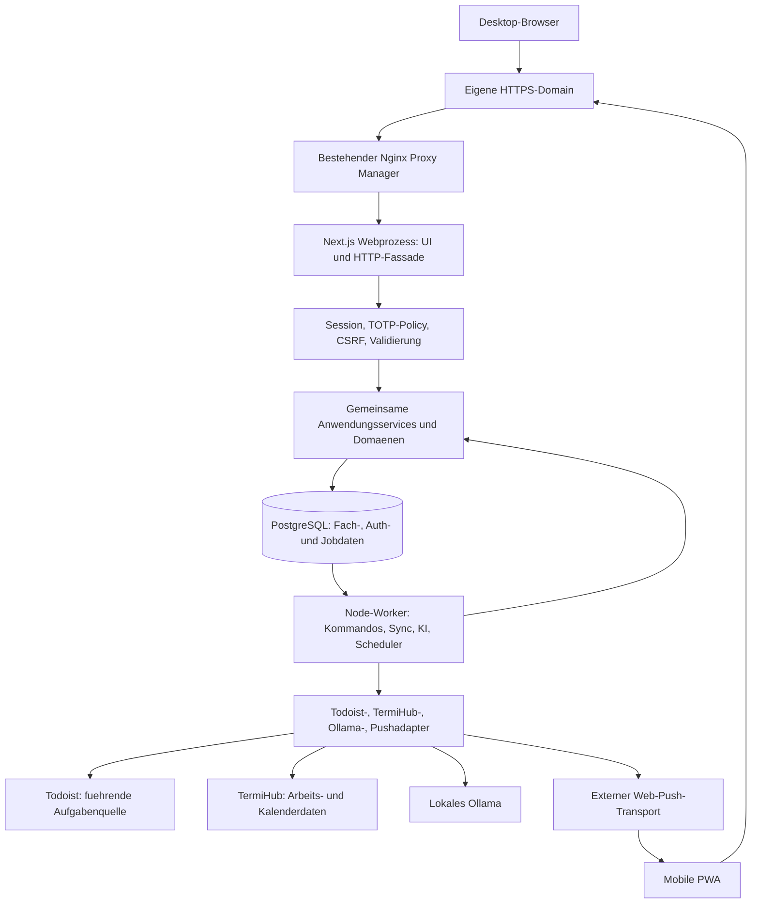
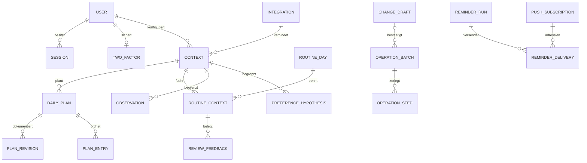
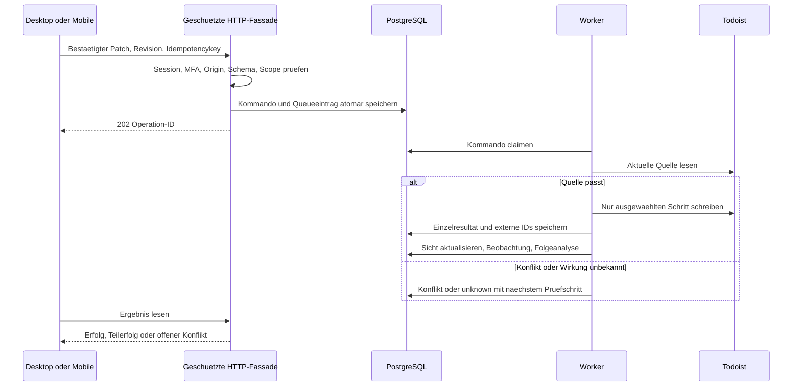

> Historische Planungsgrundlage vom 14. Oktober 2026. E1.1-Auftrag und aktuelle ADRs gelten vorrangig; siehe [Architekturübersicht](README.md). Persönliche lokale Verweise wurden entfernt.

# Helios 2.0 - technische Zielarchitektur fuer den Neuaufbau

Stand: 14. Oktober 2026. Planungsstatus: technische Empfehlung, keine Implementierungsfreigabe.

## 1. Entscheidung und verbindliche Grundlage

**Empfehlung: durchgaengiger TypeScript-Stack mit Next.js/React, schlankem modularen Backend im selben Projekt, PostgreSQL, Drizzle und einem separaten Node-Worker mit pg-boss.** Better Auth mit Username-/TOTP-Unterstuetzung, Argon2id und serverseitigen widerrufbaren Sitzungen bildet die Authentifizierungsbasis. Ollama bleibt ausschliesslich lokal. Desktop und Mobile teilen API, Fachlogik und Daten, verwenden unterschiedliche Layouts.

Variante C ist durch den Auftraggeber beschlossen. Es gibt keine erneute A/B/C-Evaluation und keine Verpflichtung zur Wiederverwendung alter Module. Neue Codebasis und neue lokale Datenbank, keine Uebernahme von Helios-1.0-Einstellungen, Plaenen oder Analysen. Bestehende Todoist-Inhalte bleiben erhalten. Versionsmigrationen innerhalb des neuen Systems sind trotzdem erforderlich.

| Grundlage                                                                        | Verbindlicher Stand / Bedeutung                                                                                                                                                                       |
| -------------------------------------------------------------------------------- | ----------------------------------------------------------------------------------------------------------------------------------------------------------------------------------------------------- |
| [Lastenheft](https://app.notion.com/p/3f77667a045981c0b688c82885b82ca1)          | 79 LH-Referenzen, fachliche Freigabe 12. Oktober, F1-F5 und mobile Praezisierungen 13. Oktober; gelesener Seitenstand `2026-10-13T06:46:12.043Z`. Historische Entwurfsmarkierungen sind uebersteuert. |
| [ADR-001 bis ADR-004](https://app.notion.com/p/3f87667a04598161aae9f9f5550b59cf) | Dokumentiert am 14. Oktober, Quellenstand `2026-10-13T22:45:35.238Z` in UTC. Hosting/NPM, eigene Passwort+TOTP-Anmeldung, Neuaufbau, dynamische Kontextsettings verbindlich.                          |
| [Sites-Design V2](https://helios-2-prototyp.greenbream.chatgpt.site)             | Projekt `appgprj_6acd346b3f088191a4d058c1815264d0`, Version 2, Quellcommit `f01316c03f04ae64db38dac8b8ccd654d045ef50`. Desktop-Referenz ist bestaetigt. Keine neue Desktop-Designrunde erforderlich.  |
| historische lokale Referenz (nicht öffentlich übernommen)                        | Technische Befunde/Designbeschreibung verwendbar. Variante-B-Empfehlung und Alt-Datenuebernahme sind ueberholt. Datei bleibt als historische Referenz unveraendert.                                   |
| historische lokale Referenz (nicht öffentlich übernommen)                        | Ausschliesslich diese drei Planungsdokumente erstellen; keine Anwendung, Abhaengigkeiten, Datenbank oder Docker-Konfiguration aendern.                                                                |

ADR-001 legt eigenen Linuxserver, Docker Compose, bestehendes Nginx Proxy Manager (NPM), eigene HTTPS-Domain und geschuetzte interne Dienste fest. VPN ist optional, kein notwendiger Zugangsweg. ADR-002 legt einen lokalen Benutzer, Benutzername/Passwort, verpflichtendes TOTP, Recovery und widerrufbare Sitzungen fest; vertrauenswuerdige Geraete maximal 30 Tage. ADR-003 legt Neuaufbau ohne lokale Altdatenmigration fest. ADR-004 legt alle Kontext-/Projektzuordnungen in Einstellungen fest; keine automatische Projektumorganisation.

Nicht als neue offene Entscheidungen behandeln: Todoist fuehrt Tasks/Epics/Ziel/Checkliste, ein Projekt pro Kontext, Eingang ohne KI, zyklische Reserve, unabhaengige Kontextplaene, manuelles Epicende, keine automatische Umplanung, lokale KI, korrigierbares Lernen ab erster vollstaendiger Version, eigener mobiler Routinebereich und Push. Verbleibende Entscheidungen stehen ausschliesslich in [offene Entscheidungen](helios-open-decisions.md).

### Quellen- und Pruefgrenzen

Notion-Quellen wurden erneut gelesen, ohne gemeldete Abschneidung/unbekannte Bloecke. Sites-Projektzugriff und V2 wurden erneut bestaetigt. Die vorher ausgewertete Designbeschreibung und das Vorschaubild sind verfuegbar; keine neue erfolgreiche Live-Interaktionspruefung. Beschriebene Drag-and-drop-/Dialogablaeufe sind Referenz, kein hier bestandener Browsertest. Die mobile Gestaltung braucht noch eine konkrete Spezifikation.

Oeffentliche technische Dokumentation wurde am 14. Oktober geprueft. Sie belegt Faehigkeiten und Grenzen der Technologien, keine erfolgreiche Helios-Integration. Keine Authbibliothek installiert, kein Todoist-Testvorgang ausgefuehrt, kein TermiHub-Vertrag erfunden. Patchversionen/Images werden erst beim freigegebenen Projektstart kompatibel ausgewaehlt und fest gepinnt; keine Beta-/Latest-Tags als Produktionsvertrag.

## 2. Technologieentscheidung

### 2.1 Optionen fuer den Gesamtstack

Die Buchstaben hier bezeichnen Technologieoptionen, nicht die bereits entschiedenen Neuaufbauvarianten.

| Kriterium                      | Option A: Next.js + FastAPI/Python                                                                          | Option B1: Next.js + TypeScript-Backendmodule                                                      | Option B2: React/Next.js + Fastify/NestJS                                              |
| ------------------------------ | ----------------------------------------------------------------------------------------------------------- | -------------------------------------------------------------------------------------------------- | -------------------------------------------------------------------------------------- |
| Wartung durch einen Entwickler | Zwei Sprachen, Build-/Testketten und DTO-Vertraege; gut bei bewusstem Python-Schwerpunkt.                   | Eine Sprache und gemeinsame Vertrags-/Fachmodule; geringste Anzahl eigener Serverkomponenten.      | Eine Sprache, aber zusaetzlicher HTTP-Server und Integrations-/Buildgrenzen.           |
| Fachlogik/Testbarkeit          | Sehr gute Pydantic-/Service-/pytest-Struktur.                                                               | Frameworkfreie TS-Domaenen, Zod-Vertraege, Vitest; Web und Worker nutzen denselben Kern.           | Gute Trennung; Nest bringt mehr DI-/Modulkonventionen, Fastify ist schlanker.          |
| Authentifizierung              | Argon2/TOTP/Sessions moeglich, komplette Policy muss ueber passende Komponenten integriert werden.          | Better Auth integriert Credentials, Username, TOTP/Recovery und Sessions; Helios-Policy ergaenzen. | Gleiche Bibliothek moeglich, weitere Adapter-/Cookie-/Proxyintegration.                |
| Lokale KI                      | Python angenehm, wenn eigene ML-/Datenpipelines vorgesehen sind.                                            | Ollama ist HTTP mit JSON-Schema; kein Pythonprozess allein fuer Modellaufrufe noetig.              | Gleiche Ollama-Moeglichkeiten.                                                         |
| Parallelitaet/Jobs             | Separater Worker und dauerhafte Queue trotzdem erforderlich; keine API-BackgroundTasks als Schedulerersatz. | Permanenter Node-Webprozess plus separater Worker; Jobs in PostgreSQL.                             | API plus Worker, haeufig zusaetzlicher Frontendprozess.                                |
| Desktop/Mobile/PWA             | Next.js teilt UI, API muss mit Python abgestimmt werden.                                                    | Gleicher Origin und Featurekern, separate Layouts; keine Cross-Origin-Auth.                        | Gleicher Origin ueber Proxy moeglich, mehr Routingkonfiguration.                       |
| Ressourcen/Dienste             | Web, API, Worker, DB; keine gemessenen Verbrauchswerte.                                                     | Web inklusive HTTP-Fassade, Worker, DB; Ollama/NPM bestehen separat.                               | Mit Vite-SPA im APIprozess ebenfalls drei Dienste; mit separatem Next-Webprozess vier. |
| Codex-Verstaendlichkeit        | Gut mit klaren Schemas/Servicegrenzen, aber doppelte Vertragsdefinitionen vermeiden.                        | Direkte TS-Vertraege, wenige Grenzen, kurze AGENTS-Anweisungen.                                    | Gut, aber mehr Framework-/DI-Konventionen.                                             |

**B1 ist empfohlen.** Langlaufende Arbeit liegt im Worker, nicht in Next-Requests. Next.js ist HTTP-/UI-Adapter eines fachlich modularen Monolithen; keine Fachlogik in Reactkomponenten, keine Server-Action-Ketten als Jobplattform. Standard-JSON-Endpunkte und serverseitige Modulaufrufe genuegen, kein zusaetzlicher GraphQL-/tRPC-Zwang.

[Next.js dokumentiert Route Handlers als oeffentliche HTTP-Endpunkte](https://nextjs.org/docs/app/guides/backend-for-frontend): sie benoetigen selbst Auth/Validierung. Server Components koennen den gleichen geschuetzten Anwendungsservice direkt aufrufen, statt intern die eigene HTTP-Route aufzurufen. FastAPI ist mit [Pydantic/OpenAPI und Dependency Injection](https://fastapi.tiangolo.com/features/) ebenfalls geeignet. Die Entscheidung fuer TS folgt geringerer Betriebs-/Vertragskomplexitaet in diesem Neubau, nicht einer behaupteten technischen Untauglichkeit von Python.

Fastify ist eine sinnvolle Alternative fuer einen spaeter begruendeten separaten API-Server; NestJS ist bei diesem Einzelbenutzerdienst wegen zusaetzlicher Strukturkonventionen nicht bevorzugt. Django mit vorhandener Auth-/OTP-Integration waere eine weitere tragfaehige Pythonoption, bietet fuer den bestaetigten React-Interaktionsentwurf jedoch keinen ausreichenden Vorteil fuer eine dritte Toolchainentscheidung.

Frontendvergleich: Next.js integriert Routing, verschachtelte Desktop-/Mobilelayouts, HTTP-Fassade und Server-/Clientgrenzen. Das ist der empfohlene zusammenhaengende Rahmen, verlangt aber bewusst kontrolliertes Caching und konsequente Service-Guards. React mit [Vite](https://vite.dev/guide/) plus Fastify ist fuer eine weitgehend clientseitige App ebenso tragfaehig: statischen Build im APIprozess ausliefern, kein zusaetzlicher Frontenddienst zwingend. Router/Auth-/APIadapter werden dabei expliziter zusammengesetzt. SvelteKit ist eine weitere Fullstackoption, wuerde hier eine andere UI-Komponenten-/Testkonvention einfuehren. Die Wahl Next/React ist eine Wartungsentscheidung, keine SEO-Anforderung und keine Pflicht zur Altcodewiederverwendung.

### 2.2 Datenbank: PostgreSQL statt SQLite

| Kriterium              | SQLite                                                                                                     | PostgreSQL                                                                                         |
| ---------------------- | ---------------------------------------------------------------------------------------------------------- | -------------------------------------------------------------------------------------------------- |
| Betrieb                | Sehr klein, keine eigene DB-Serviceverwaltung.                                                             | Ein weiterer Compose-Dienst, Volume/Backup/Updates zu betreiben.                                   |
| Gleichzeitige Writes   | Fuer einen Benutzer moeglich, Writes werden serialisiert; WAL hilft Lesern, schafft keine mehreren Writer. | Zeilenbezogene Sperren und robuste Transaktionen fuer Web, mobile Aktionen und Worker.             |
| Jobs/Scheduler         | Eigener SQLite-Claim-/Lease-/Recoverycode oder weitere Queueintegration.                                   | pg-boss nutzt dieselbe DB; keine Redisinstanz erforderlich.                                        |
| Datenregeln            | Constraints/Transaktionen moeglich; kurze Writes/Busystrategie wichtig.                                    | Unique/Partial-Unique, Transaktionen und Row Locks gut fuer Planrevisionen, Recovery und Dispatch. |
| Test-/Betriebsparitaet | Einfach lokal, externe Queuewahl kann Unterschiede erzeugen.                                               | Dev/Test/Produktion auf gleicher Engine, Konkurrenzfaelle real testbar.                            |
| Backup                 | Konsistentes Backup moeglich, kein blindes Kopieren einer schreibenden Datei.                              | Konsistenter logischer Dump/Restore, bewusste Rollen-/Secretmitnahme.                              |

SQLite waere nicht fachlich ausgeschlossen. Fuer die gewaehlte Job-/Auth-/Konsistenzarchitektur ist PostgreSQL die robustere Gesamtloesung bei geringer eigener Speziallogik. Der Single-User-Status bedeutet nicht einen einzigen Schreibprozess. Grundlagen: [SQLite-Isolation](https://sqlite.org/isolation.html), [PostgreSQL-Locking](https://www.postgresql.org/docs/current/explicit-locking.html). Der Mehrverbrauch ist auf Zielhardware zu messen; keine unbelegten RAM-/Latenzgarantien.

### 2.3 Konkrete Komponenten

| Bereich                | Empfehlung / Begruendung                                                                                                                                                     |
| ---------------------- | ---------------------------------------------------------------------------------------------------------------------------------------------------------------------------- |
| Web/UI                 | Next.js App Router, React, TypeScript; Sites-V2-Tokens/Bedienung neu implementieren.                                                                                         |
| Backend                | Frameworkfreie TS-Anwendungsservices/Domaenen; Next Route Handlers als duenne HTTP-Fassade. Permanente Node-Runtime, kein Static Export/Edge-Zwang.                          |
| DB/ORM                 | PostgreSQL, Drizzle ORM und Drizzle Kit; SQL-Migrationen reviewen und versionieren. Prisma ist komfortabel, Drizzle ist hier wegen SQL-Naehe und Queueintegration bevorzugt. |
| Vertraege              | Zod fuer Ein-/Ausgaben und JSON-Schema, gemeinsame DTO-Pakete; unbekannte/falsche Felder und semantisch unzulaessige Patches ablehnen.                                       |
| Jobs                   | Separater Node-Worker, pg-boss fuer Claim/Retry/Scheduling. Keine Eigenqueue neben pg-boss und kein Redis/Celery/n8n als Voraussetzung.                                      |
| Auth                   | Better Auth mit Username-/TOTP-Plugins, Argon2id ueber etablierte Implementierung; DB-Sessions, Helios-Policy/Guards.                                                        |
| KI                     | Lokaler Ollama-HTTP-Adapter, `/api/chat` mit JSON-Schema und zusaetzlicher Zod-/Semantikpruefung. Kein Cloudfallback.                                                        |
| PWA/Push               | Web-App-Manifest, kleiner versionierter Service Worker, etablierte Web-Push-Bibliothek/VAPID im Worker. Kein Firebase-/App-Store-Zwang.                                      |
| Tests                  | Vitest fuer Domaenen/Vertraege, React Testing Library fuer UI, Playwright fuer E2E; echte isolierte PostgreSQL-Integrationstests, separater Todoist-Testaccount.             |
| Entwicklung/Deployment | pnpm-Workspace/Lockfile, unterstuetzte kompatible Node-LTS-Version, Multi-Stage-Container, Docker Compose, NPM als bestehender HTTPS-Proxy.                                  |

[Drizzle unterstuetzt generierte SQL-Migrationen und explizite Migrationausfuehrung](https://orm.drizzle.team/docs/migrations). Empfehlung: kein produktives automatisches Schema-Push. [pg-boss](https://github.com/timgit/pg-boss) bietet Postgres-basierte Jobs, Wiederholungen und Scheduling; Kommandodaten und Jobeinreihung sollen in derselben DB-Transaktion erfolgen. Der Drizzle-/Queue-Transaktionsadapter wird in Etappe E1 verifiziert. Retry/Singleton ersetzt keine Idempotenz externer Todoist-/Pushwirkungen.

| Vergleich                    | Empfehlung und bewusst akzeptierter Trade-off                                                                                                                                                                                                                                                                                                                                                            |
| ---------------------------- | -------------------------------------------------------------------------------------------------------------------------------------------------------------------------------------------------------------------------------------------------------------------------------------------------------------------------------------------------------------------------------------------------------- |
| ORM: Drizzle vs. Prisma      | Drizzle: TS-Schema und gut sichtbare SQL-/Transaktionsgrenzen. Prisma: generierter Client/eigenes Schemamodell und ebenfalls Migrationen. Drizzle bleibt empfohlen; explizite SQL-/Constraintsarbeit gehoert dazu.                                                                                                                                                                                       |
| Queue: pg-boss vs. BullMQ    | pg-boss passt direkt zur Postgres-first-/Transaktionsarchitektur. BullMQ mit Redis waere ein weiterer Dienst; die aktuelle Dokumentation beschreibt auch einen optionalen PostgreSQL-Backendweg. Diesen nicht als unmoeglich darstellen. pg-boss bleibt wegen unmittelbarem Postgres-Fokus und dokumentierter ORM-Transaktionsanbindung bevorzugt; konkrete Versions-/Adaptertests bleiben erforderlich. |
| Queue/Scheduler selbst bauen | Weniger Bibliotheksoberflaeche, dafuer eigener Claim-/Lease-/Retry-/Recoverycode. Nicht empfohlen. Fachliche Tages-/Reminderzeitregeln bleiben in Helios, unabhaengig von der Queuebibliothek.                                                                                                                                                                                                           |

Quelle zur alternativen Postgres-Queue: [BullMQ PostgreSQL backend](https://docs.bullmq.io/guide/postgresql). Die Empfehlung behauptet weder gemessene Performancevorteile noch garantierte externe Exactly-once-Wirkung.

## 3. Prozesse, Module und Datenverantwortung



**Drei neue dauerhafte Dienste:** Web, Worker und PostgreSQL. NPM und Ollama sind vorhandene Infrastruktur. Migrations-/Bootstrap-/Backupkommandos sind kurzlebige Verwaltungsablaeufe, keine weiteren dauerhaft laufenden Microservices. Worker und Web stammen aus derselben Codebasis und nutzen denselben Domaincode.

| Modul                  | Verantwortung                                                                                                 |
| ---------------------- | ------------------------------------------------------------------------------------------------------------- |
| identity               | Lokaler Benutzer, Bootstrap, TOTP/Recovery, Sessionpolicy, Step-up, Sicherheitsereignisse.                    |
| contexts               | Dynamische Arbeitgeber/Privat, Theme, genau ein Projekt, TermiHub-Zuordnung/Verbindungstest/Deaktivierung.    |
| tasks/inbox            | Todoist-Lesesicht, explizite CRUD-Kommandos, globaler manueller Eingang, Labels/Datum/Kommentare.             |
| epics/markdown         | Native Hierarchie, verlustarme Ziel-/Checklist-/Linkbearbeitung und Abschlussregeln.                          |
| planning/focus/reserve | Kontextplaene/Revisionen, begruendete Auswahl, Fokuszeiger, stabile Ordnung/zyklische Reserve.                |
| routine/review         | Globale Schritte und Kontextreview, Skip/offen, Historie, gemeinsamer Fortschrittsworkflow.                   |
| ai/drafts              | Kleine versionierte Use Cases, validierte Entwuerfe, unverlierbare Freitexte, keine autonome Inhaltsmutation. |
| operations/sync        | Bestaetigte Kommandos/Einzelschritte, Taskinstanzen, Konflikte/Teilerfolge, Reconciliation.                   |
| learning               | Lokale Beobachtungen, globale Fuehrung und getrennte Kontextauswahlhypothesen, korrigierbare Schluesse.       |
| problems               | Zentrale technische Probleme, Wiederauftreten, geprueft getrennt von behoben.                                 |
| reminders              | Abo/Einstellungen, Tageszeitberechnung, erste/Folge, Versandnachweise.                                        |

**Todoist fuehrt** Projekte, Taskinhalt, Parent/Epic, Status/Abschnitt/Abschluss, geplantes Datum, Deadline, Kommentare/Labels, `## Ziel` und `## Checkliste`. **Helios fuehrt** Kontextkonfiguration, Plaene/Fokus/Reserve/Routine, AI-/Fortschrittsentwuerfe, Aufwandsschaetzungen, Hypothesen, Auth/Sessions, Probleme/Jobs und Push. **TermiHub fuehrt** Arbeitsbeginn/-dauer/-kontext/Termine. Lokale Todoist-Projektionen sind schreibgeschuetzte Caches/Historien, keine zweite editierbare Aufgabenwahrheit.

Kontextanlage/-zuordnung speichert nur Helios-Konfiguration. Verbindungstest und Erstimport sind lesend. Keine automatische Verschiebung, Umbenennung oder Abschnittsumorganisation bestehender Todoist-Inhalte. Falls fehlende benoetigte Abschnitte eingerichtet werden sollen, gibt es eine eigene bewusste, vorab angezeigte Einrichtungskommando-Aktion; bestehende Tasks werden dadurch nicht verschoben. Fachlich erlaubte spaetere Status-/Inhaltsaenderungen laufen ausschliesslich ueber definierte Regeln/Benutzerentscheidungen.

## 4. Authentifizierung und oeffentlicher HTTPS-Zugang

### 4.1 Bibliothek statt selbst gebautem Authsystem

Better Auth unterstuetzt [Username-Anmeldung](https://better-auth.com/docs/plugins/username) und [TOTP mit Backupcodes](https://better-auth.com/docs/plugins/2fa). Die dokumentierte Credential-Anmeldung kann eine 2FA-Challenge statt einer abgeschlossenen Session liefern. Nicht alle alternativen Anmeldemethoden werden automatisch gleich geschuetzt. Fuer Helios wird deshalb nur der gewollte Username-/Passwort-/TOTP-Weg angeboten; keine Social-/Magic-Link-/Passkey-/SMS-Ersatzwege und kein offener Registrierungsweg.

Eine schlanke Eigenintegration aus Passwort-, TOTP- und Sessionbibliotheken waere moeglich, verlangt jedoch eigene Lifecycle-/Replay-/Recovery-/Cookie-/Revocationintegration. Externe IdP-Dienste wie Keycloak bringen fuer ein Konto einen weiteren Dienst. Better Auth ist empfohlen, aber in E1 sind die gewaehlte Version und alle Helios-Policies real zu testen. Kryptografie wird weder selbst erfunden noch aus Prompts uebernommen.

Die Bibliothek verwendet nicht automatisch Argon2id. Ihr [Credential-Adapter erlaubt eigene Hash-/Verify-Funktionen](https://better-auth.com/docs/authentication/email-password). Empfohlen wird eine gepflegte Argon2id-Implementierung; Parameter auf dem Server messen, mindestens die [OWASP-Untergrenze](https://cheatsheetseries.owasp.org/cheatsheets/Password_Storage_Cheat_Sheet.html) einhalten. Ein moeglicher Startbenchmark ist 64 MiB, drei Iterationen, Parallelitaet 1; das ist eine Empfehlung, kein bereits gemessener Wert.

### 4.2 Sichere Erstinitialisierung

1. Nach freigegebenem Deployment erstellt ein lokales Verwaltungs-CLI unter Serverkontrolle genau einen `pending_setup`-Benutzer, mit Username und interaktiv eingegebenem Passwort. Kein Defaultkonto/-passwort und kein Passwort in Compose/Logs.
2. Ein hochentropischer, einmaliger Setupnachweis wird nur gehasht gespeichert, mit kurzer Gueltigkeit; er wird ueber POST eingegeben, nicht als Token in URL/Proxylog transportiert. Zweiter Bootstrapversuch bei vorhandenem Konto wird abgelehnt.
3. Setup-only-Sitzung zeigt lokal erzeugten TOTP-QR/Secret, verlangt echten Code und bestaetigte Sicherung der Recoverycodes. Keine fremde QR-Webseite, kein normaler Task-/Settingszugriff vorher.
4. Erst nach erfolgreicher Enrollmentpruefung wird das Konto `active`; der Setupnachweis verfellt/verbraucht sich. Erneute Registrierung bleibt serverseitig gesperrt.

Falls das Bibliotheksschema eine E-Mailkennung benoetigt, darf sie als interne nicht zustellbare Identitaet gefuehrt werden. Das Produkt verlangt Username, keinen E-Mail-/SMTP-Resetdienst. Der gewaehlte Bootstrapadapter muss den Bibliotheksvertrag einhalten und darf nicht durch rohe, unvalidierte Tabellenwrites Authschutz umgehen.

### 4.3 Session- und TOTP-Policy

Die folgenden Punkte sind **Helios-Sicherheitsinvarianten**, keine Behauptung, dass Bibliotheksdefaults sie automatisch erfuellen:

- Jede Fachroute und jeder direkte Server-Component-Serviceaufruf prueft eine aktive DB-Session, aktiven Benutzer und abgeschlossene MFA-Policy. Middleware/Frontendredirect allein genuegt nicht.
- Cookies `Secure`, `HttpOnly`, hostgebunden, geeigneter SameSite-Wert; keine Tokens im Browserstorage/URL. Keine Domainfreigabe fuer beliebige Subdomains. Private Antworten/SSR-Daten nicht shared cachen.
- DB-Sessions sind sofort widerrufbar. Cookie-Sessioncache wird deaktiviert; [Better-Auth-Sessioncaching kann sonst Widerruf verzogern](https://better-auth.com/docs/concepts/session-management). Keine langlebigen selbsttragenden Browser-JWTs als Hauptsession.
- Explizit vertrauenswuerdig: maximal 30 Tage absolute Laufzeit ab vollstaendiger Anmeldung, nicht durch Aktivitaet beliebig verlaengerbar. Nicht vertrauenswuerdig: vorgeschlagen 12 Stunden absolut/30 Minuten inaktiv. Step-up vorgeschlagen fuenf Minuten. Exakte kuerzere Fristen: O-03.
- Die pluginseitige `trustDevice`-Funktion kann erneute 2FA-Abfragen auslassen und ihre Frist erneuern. Sie wird fuer diese Policy nicht ungeprueft aktiviert. Helios merkt eine bereits MFA-verifizierte Session laenger; nach deren Ende braucht eine neue Anmeldung wieder Passwort/TOTP.
- Server setzt Vertrauens-/MFA-/Ablauffelder; Client darf sie nicht manipulieren. Autorisierung prueft die absolute Grenze auch bei pluginseitiger rollender Verlaengerung. Eine kopierte Cookie ist kein hardwaregebundener Geraetenachweis.
- Kritische Aktionen verlangen frisches Passwort+TOTP: Passwort/TOTP/Recoverywechsel, Sessionschutz, Secret-/Integrationswechsel, Kontextprojekt-Neuzuordnung und sensibler Export. Logout/sofortiger Widerruf bleiben ohne erneute Huerde moeglich.
- Keine oeffentliche rohe Auth-API, die Signup oder MFA-Abschaltung neben der UI erlaubt. Methoden-/Routenallowlist, `disableSignUp` und Policy-Guard auch an Bibliotheksendpunkten. TOTP bleibt verpflichtend, ein temporaerer Recovery-/Rotationzustand erlaubt nur diesen eingeschraenkten Ablauf.
- Recoverycode ist einmalig und atomar verbraucht. Nach Passwort+Recovery sind neue TOTP-Einrichtung und Sessionwiderruf vorgesehen; kein dauerhafter MFA-Downgrade. Falls auch Passwort/Codes verloren sind: lokaler, auditierter Admin-Recovery unter Serverkontrolle, keine Sicherheitsfragen.
- TOTP-/Recoverygeheimnisse verschluesselt mit gepflegten Komponenten, getrennte gesicherte Schluessel; Einmalcodes/QR/Passwoerter nicht loggen. Gleichzeitiger Codeverbrauch und Challenge-Replay werden in E1 geprueft, ohne eigene Kryptoverfahren.

### 4.4 Schutz vor Loginmissbrauch und Webangriffen

Limitierung vor teurem Passwortverify, getrennte Username-/IP-/Challengegrenzen mit Backoff, generische Antworten ohne Benutzerexistenzleck. DB-basierter Zustand ueberlebt Restart; kein Redis allein dafuer. Vorgeschlagener Start: fuenf Fehlversuche pro Minute je Account und IP, danach zunehmende temporaere Verzoegerung; keine unbegrenzte Kontosperre als Angriffsmoeglichkeit. NPM-Header duerfen Client-IP nicht frei spoofbar machen.

Feste kanonische HTTPS-Origin, Trusted-Proxy-Adressen nur fuer tatsaechliches NPM, Host-/Originpruefung, CSRF-/Fetch-Metadata-Schutz, Requestgroessen und Laufzeiten begrenzen, CSP und sichere Markdown-/Linksanitierung. Grundlage fuer Header-/Proxypruefung ist die [Better-Auth-Sicherheitsdokumentation](https://better-auth.com/docs/reference/security); alle Fachmutationen brauchen zusaetzlich ihre eigenen Guards. Externe Integrationsadressen serverseitig nach Allowlist/zulassbarer Netzgrenze pruefen, um SSRF zu verhindern; Pushendpoints ebenfalls validieren und nicht beliebige URLs vom Worker abrufen lassen.

Push oeffnet nur einen relativen erlaubten Routinepfad. Bei abgelaufener Session: Login -> TOTP -> urspruenglicher erlaubter Pfad -> serverseitig naechster offener Schritt. Kein externes frei waehlbares `returnTo`, kein Auto-Login per Pushpayload.

## 5. Konzeptionelles Datenmodell

Alle Namen sind Planung, keine angelegten Tabellen. IDs fuer externe Todoist-/TermiHub-Objekte sind opaque Strings. Lokale Zeitpunkte UTC mit Zeitzone; Tagesplanung/Erinnerungswochentag verwenden den konfigurierten lokalen Kalendertag. Revisionen als monotoner Integer; Snapshot-/Patch-JSON ist typisiert und schemaversioniert. Historische Referenzen werden nicht per Cloudtask-Cascade geloescht.

### 5.1 Identitaet und Konfiguration

| Modell / Zweck                          | Zentrale Felder / Beziehungen                                                                                            | Eindeutigkeit / Uebergaenge / Quelle / Loeschverhalten                                                                                                                                |
| --------------------------------------- | ------------------------------------------------------------------------------------------------------------------------ | ------------------------------------------------------------------------------------------------------------------------------------------------------------------------------------- |
| Auth `user` / lokales Konto             | ID, normalisierter Username, Status, MFAflag; Bibliotheksprofil plus Helios-Policy.                                      | Username unique, genau ein provisioniertes Konto durch Bootstraptransaktion; pending_setup -> active -> recovery/disabled. Helios fuehrt. Kein oeffentliches Userdelete.              |
| Auth `account` / Credential             | User-FK, Provider `credential`, Argon2id-Passworthash.                                                                   | Bibliotheks-Providerkey unique; Passwortwechsel mit frischer MFA und Widerruf. Kein zweiter Passwortspeicher.                                                                         |
| Auth `two_factor` / Enrollment+Recovery | User-FK, geschuetztes Secret, geschuetzte Recoverycodes/Verbrauchszustand, Enrollmentrevision.                           | Pro Konto ein aktiver Faktor; pending -> verified -> controlled rotation/recovery. Konkurrenzverbrauch testen; Codes nicht mehrfach gueltig.                                          |
| Auth `session` / Geraetesitzung         | User-FK, Token nach Bibliotheksvertrag, Start/absolute/Idlegrenze, MFA-/Step-upzeit, Trustflag, Geraetelabel.            | Token/ID unique; pending Authchallenge ist keine Fachsession; active -> expired/revoked. Logout sofort. Kein Vertrauen allein aus Clientlabel.                                        |
| Auth `verification` / kurze Challenges  | Zweck/Binding, Tokenverifier, Ablauf/Verbrauch.                                                                          | Einmaliger zweckgebundener Verbrauch, eingeschraenkte Setup-/Recoverysession. Bibliotheks-/Helios-Adapter ohne zweite parallel gueltige Challengewahrheit.                            |
| `security_events` / Sicherheitsnachweis | Actor, Sessionreferenz, Ereigniscode, Zeitpunkt, reduzierte Herkunft.                                                    | Append-only bis definierte Aufbewahrung; keine Credentials/rohen Cookies. Auth-Historie ueber Sessionende hinaus erhalten.                                                            |
| `integrations` / Verbindung+Syncstatus  | Typ Todoist/TermiHub, URL, verschluesselte Credentials, Konfigrevision, letzter Test/Sync, Cursor/Fehlerstatus.          | Eine aktive Instanz pro benoetigtem Integrationstyp fuer diesen Benutzer; pending/ready/degraded/disabled. Helios-Konfiguration, externe Daten bleiben extern. Secretwechsel step-up. |
| `contexts` / dynamischer Arbeitsraum    | User/Integration-FK, Privat/Arbeitgeber, Name/Theme, Projekt-ID, optionale TermiHub-ID, Sectionmapping, active/revision. | Ein Privatkontext; aktiver Kontext genau ein Projekt; ein Projekt nicht zwei Arbeitgebern zuweisen. Deaktivieren stoppt Jobs, erhaelt Historie; keine Cloudprojektloeschung.          |

Authtabellen werden anhand des festgelegten Bibliotheksschemas generiert/reviewt; die Bezeichnungen oben sind logische Namen. Die [Session-/Accountkonzepte](https://better-auth.com/docs/concepts/database) werden nicht als ungetestetes selbst gebautes Authschema ersetzt. TOTP-/Recoveryzustand moeglichst im vorhandenen Pluginmodell, nicht noch einmal in parallelen Tabellen speichern.

### 5.2 Aufgabenprojektion, Plaene und Routine

| Modell / Zweck                           | Zentrale Felder / Beziehungen                                                                                                        | Eindeutigkeit / Uebergaenge / Quelle / externe Aenderung                                                                                                                                                     |
| ---------------------------------------- | ------------------------------------------------------------------------------------------------------------------------------------ | ------------------------------------------------------------------------------------------------------------------------------------------------------------------------------------------------------------ |
| `task_projections` / lesender Cache      | Integration/Task-ID, Kontext/Projekt/Parent/Abschnitt, Inhalt/Datum/Deadline, Quellfingerprint/retrieved_at, externer Zustand.       | Integration+Task-ID unique; active/completed/deleted/unknown. Todoist fuehrt; Cache nie direkt als editierbarer Master. Fehlender Active-Task ist nicht automatisch abgeschlossen.                           |
| `task_analysis` / lokale Ableitung       | Task/Instanzreferenz, Kontext, Quellen-/Abhaengigkeitsfingerprint, Klarheit/Ausfuehrbarkeit/Aufwand/naechster Schritt, Bestaetigung. | Taskinstanz+Analyseversion unique; current/stale/failed. `stale_planned_date` getrennt von `unclear_content`; unveraenderte Ist-klar-Fassung nicht wieder markieren.                                         |
| `daily_plans` / Kontexttag               | Kontext-FK, lokales Datum, aktuelle/bestaetigte Revision, Fokus-Entry, Zustandsrevision.                                             | Kontext+Datum unique. Vorlaeufige Vorbereitung darf ersetzt, bestaetigte Geschichte nicht vernichtet werden.                                                                                                 |
| `plan_revisions` / Auswahlgeschichte     | Plan-FK, Revisionsnummer, Status, Quellen, Kriterien/Erklaerung, unveraenderlicher Bestaetigungssnapshot.                            | Plan+Version unique; draft -> confirming -> confirmed -> superseded/archived. Teilerfolg bleibt unbestaetigt mit Operationsnachweis. Manuelles Neuplanen erzeugt neue Revision.                              |
| `plan_entries` / Haupt/Reserve           | Plan-FK, Task-/Instanzreferenz, main/reserve, Position, actionstatus, Gruende/aktueller Zustand.                                     | Plan+Taskinstanz unique, Position pro Bucket eindeutig; ready/skipped/complete_pending/done/removed. Fokus-FK muss zu diesem Plan gehoeren. Reorder/Rotation atomar, Historie im Revisions-/Aktionsnachweis. |
| `routine_days` / globale Routine         | User/Tag, started_at, Eingang/Problem-Schrittstatus, Revision.                                                                       | User+Routinenkalendertag unique; Schritt open/started/done/skipped_open. Beginn ist nicht Abschluss; Skip bleibt offen.                                                                                      |
| `routine_contexts` / Kontextschritte     | Routine-/Kontext-FK, Review/Anreichern/Planung als begrenztes Step-JSON, Quellplanreferenz, Revision.                                | Routine+Kontext unique; Kontextwechsel behaelt Stand, Globalzustand bleibt getrennt. Deaktivierte Kontexte historisch erhalten.                                                                              |
| `review_feedback` / belegte Rueckmeldung | Routinekontext/Planentry, not_started/partial/completed/unknown, bestaetigter Fortschrittsentwurf, Zeitpunkt.                        | Review+Taskinstanz unique; absent != not_started. Externe Abschluesse mit Nachweis reconciliieren, historische Freitexte nach Retention.                                                                     |
| `calendar_snapshots` / TermiHub-Sicht    | Kontext/Tag, Zeitzone/Arbeitsintervalle/Termine/Beginn/Minuten, Quellenstand/Aktualitaet.                                            | Kontext+Tag+Quellversion; fresh/stale/unavailable. TermiHub fuehrt. Ueberlappende Termine per Intervallunion, kein Orts-/Zeitblockfilter.                                                                    |

Epics/Ziele/Checklisten brauchen keine lokalen fuehrenden Entitaeten. Native Parentbeziehung und Markdowninhalt kommen aus Todoist; Epic-Verstaendnis ist versioniertes Analyseergebnis. Dokumentenlinks bleiben menschenlesbare Task-/Epic-Inhalte. Wartestatus fuehrt Todoist-Abschnitt; menschenlesbarer Ablagevertrag fuer Wartedetails/Nachfassen siehe O-09, ohne zweiten lokalen Taskmaster.

Fuer Ziel-/Checklistabschnitte einen bewaehrten Markdown-AST-Parser wie [remark/mdast](https://github.com/remarkjs/remark) verwenden. Nur die ausgewaehlten Sourcebereiche patchen, fremde Beschreibungsabschnitte unveraendert erhalten; Mehrdeutigkeit doppelter Zielabschnitte als Konflikt behandeln. Roundtrip-/Fremdinhaltstests sind erforderlich, keine pauschale Regexzerlegung oder gesamte Neuformatierung der Beschreibung.

### 5.3 Entwuerfe, Operationen, Lernen und Push

| Modell / Zweck                                 | Zentrale Felder / Beziehungen                                                                                | Eindeutigkeit / Uebergaenge / Quelle / externe Aenderung                                                                                    |
| ---------------------------------------------- | ------------------------------------------------------------------------------------------------------------ | ------------------------------------------------------------------------------------------------------------------------------------------- |
| `ai_runs` / nachvollziehbarer Lauf             | Use Case/Task/Kontext, Prompt-/Schema-/Modellversion, Quellenfingerprint, Job-ID, Status/Messdaten.          | Stabile Lauf-/Fingerprintdedupe; queued/running/valid/invalid/stale/failed. Kein voller Prompt im allgemeinen Log, kein zweiter Queueclaim. |
| `change_drafts` / editierbarer Vorschlag       | User/Kontext/Task, Originalfreitext, typisierte Einzelpatches, Auswahl, Basisfingerprint, Status.            | Draft-ID/Version; generated -> edited -> confirmed/rejected/stale/applied. Freitext bis Erfolg erhalten, Quelle vor Anwenden nachlesen.     |
| `operation_batches` / Benutzerkommando         | Actor/Session/Kontext, Idempotencykey+Requesthash, Ziele/Instanzen, lokale erwartete Revision, Status.       | User+Kommandokey unique; accepted/running/partial/succeeded/failed/unknown/cancelled. Anderer Inhalt mit gleichem Key -> Konflikt.          |
| `operation_steps` / einzelne Wirkung           | Batch-FK, Patchart, Ziel/Instanz, externe erzeugte IDs, Ergebnis/Versuch/Claim.                              | Batch+Step unique; pending/in_flight/succeeded/failed/unknown/skipped. Nach Timeout erst reconciliieren, nicht blind neu erzeugen.          |
| `observations` / Fachereignis                  | User/Kontextscope, Aktion/Quelle, Task-/Plan-/Revisionreferenz, payloadversion, Zeitpunkt.                   | Ereignis-ID unique/deduped; append-only bis Retention. Kein Ereignissourcing-Zwang. Daten verschiedener Arbeitgeber getrennt.               |
| `preference_hypotheses` / vorsichtiger Schluss | Scope global/context, Beleg-Eventreferenzen, Text/Unsicherheit, Benutzerkorrektur/Status.                    | Versionierte Hypothese, proposed/confirmed/corrected/rejected/retired. Explizite Praeferenz vorrangig; ein Skip keine dauerhafte Abwertung. |
| `problems` / zentrale Fehler                   | Komponente/Scope/Code/Fingerprint, erste/letzte Sichtung, count, redigierte Details, checked_at/resolved_at. | Wiederkehrender Problemkey unique; open/reviewed/resolved, Wiederauftreten oeffnet erneut. Pruefen ist nicht Beheben.                       |
| `reminder_settings` / globaler Zeitvertrag     | User, Standardzeit, Zeitzone, Wochentage, Beginn-Vorlaufoption, Folgeabstand, Revision.                      | Ein Settingsatz pro User; keine Erinnerung pro Arbeitgeber erzeugen. Aenderung ersetzt kuenftige nicht gestartete Laeufe kontrolliert.      |
| `push_subscriptions` / Geraetetransport        | User/Geraet, Endpoint/Schluessel geschuetzt, enabled/last_result, Auswahlstatus.                             | Endpointhash unique; pending/active/expired/revoked. Logout-/Geraeteverlustpolicy O-05; keine Sessiontokens als Pushdaten.                  |
| `reminder_runs` / logische Erinnerung          | User/Routinenkalendertag/first-followup, planned_at, Settingsrevision, Claim, Ergebnis.                      | User+Tag+Kind unique; planned/claimed/sent_partial/accepted/failed/unknown/suppressed. Hoechstens erste und zweite logische Erinnerung.     |
| `reminder_deliveries` / einzelner Endpoint     | Run-/Subscription-FK, Versuch, Transportannahme/-fehler/-unknown.                                            | Run+Subscription unique; Mehrgeraeteregel O-04. Erfolgreiche Annahme ist kein Zustellbeweis.                                                |

pg-boss besitzt eigene Queue-/Schedule-Metadaten. Kein eigener paralleler Job-/Lease-Tabellensatz wird entworfen. Run-/Operationsdaten bilden Fach-/Benutzernachweise, nicht eine zweite Queue. Fokus/Reserve/Schritte brauchen keine eigenen Microtabellen pro Zustand; begrenzte versionierte JSONfelder sind fuer Step-/Patchpayloads geeignet.



### 5.4 Globale Konsistenz- und Loeschregeln

PostgreSQL-Uniqueconstraints plus kurze Transaktionen sichern lokale Invarianten. Browsermutationen verwenden erwartete Aggregatrevisionen; Hintergrundjobs ebenfalls. Keine DB-Transaktion bleibt waehrend Ollama-/Todoist-/TermiHub-/Pushaufruf offen. Fuer externe Wirkungen atomar claimen, pro Taskinstanz serialisieren, Lease/heartbeat und Nachlesen; DBcommit ist keine verteilte Atomaritaet.

Reorder darf die Positionsunique nicht zwischen einzelnen Updates verletzen: passende deferred Constraints oder getestete temporaere Positionierung innerhalb derselben Transaktion. Einfache Refresh-/Mutexannahmen im Browser sind kein Ersatz. Vor Enrollment darf TWO_FACTOR fehlen; fuer ein aktives Konto ist ein verifizierter Faktor zwingend.

Kontextdeaktivierung stoppt neue Hintergrundarbeit, erhaelt Plaene/Reviews. Projektwechsel ist sicherheitskritisch, zeigt Auswirkung auf bestehende Referenzen; keine automatische Cloudtaskverschiebung. Externe Taskloeschung erzeugt Tombstone/unknown statt Cascade/erfundener Erledigung. Native Abschluss- und Wiederholungsdaten bestimmen, ob eine Karte erledigt oder eine neue Instanz derselben Task-ID vorliegt. Historische Plaene speichern den zum Zeitpunkt bekannten Stand read-only.

Repeat-Instanzkey wird aus verifiziertem Due-/Abschluss-/Aktivitaetsvertrag abgeleitet, nicht allein aus Task-ID. Bei mehrdeutigem Timeout/Instanzwechsel wird Completion `unknown`; automatische Wiederholung darf nicht die naechste Wiederholung abschliessen. Loesch-/Kommentar-/Label-/Hierarchieaenderungen invalidieren gezielt Analysen/Entwuerfe, nicht ungefragt bestaetigte Tagesreihenfolgen.

## 6. API- und Integrationskonzept

### 6.1 HTTP-Bereiche

Auth nutzt eine eng kontrollierte Fassade unter `/api/auth`; Fachendpunkte liegen unter `/api/v1`. Kein Kompatibilitaetsvertrag mit Helios 1.0. Alle folgenden Pfade sind vorgeschlagene Vertragsanordnung, keine vorhandenen Endpunkte.

| Bereich                | Zentrale Use Cases / Verantwortung                                                                                                                                                                   |
| ---------------------- | ---------------------------------------------------------------------------------------------------------------------------------------------------------------------------------------------------- |
| auth                   | Bootstrapclaim, Username/Passwort, TOTP/Recovery, kontrollierte Enrollmentrotation, Step-up, aktive Sessions/Widerruf. Keine Signup-/MFA-Disable-Umgehungsroute.                                     |
| contexts/settings      | Kontexte lesen/anlegen/aendern/deaktivieren; genau ein geladenes Projekt bewusst zuordnen, Themes/TermiHub-ID, Verbindungstest und Geheimnisse geschuetzt.                                           |
| tasks                  | Gekennzeichnete Todoist-Projektionen, filterbare Uebersicht, Detail/Kommentare; explizite Create/Update/Postpone/Delete/Close-Kommandos. Fremde Sammlungen sind nie automatische Planungskandidaten. |
| inbox                  | Globaler nativer Eingang, Einzelkarte manuell beliebigem Todoist-Projekt zuordnen, spaeter oder bewusst loeschen. Keine KI-/Projektvorauswahl.                                                       |
| plans                  | Tagesentwurf je Kontext, Auswahlgruende, Bestaetigung, bewusste Ergaenzung/Reorder/Neuplanung und Historie.                                                                                          |
| focus/reserve          | Fokuswahl ohne Ordnungswechsel, zyklischer Reserve-Skip, Abschluss, Pause bei Einzelkarte.                                                                                                           |
| routine/review         | Globaler Tagesstand, Kontextwahl, Schritte/Skip/Wiederaufnahme, Reviewfeedback und gemeinsame Fortschrittsentwuerfe.                                                                                 |
| ai/intake/drafts       | Bewusster Freitext vor Anlage -> Vorschau; Task-/Klaerungs-/Fortschritts-/SMART-Entwurf erzeugen/bearbeiten/abwaehlen/bestaetigen.                                                                   |
| epics/goals/checklists | Native Epic-/Parentansicht, verlustarmes Markdown, kontrollierter Epicabschluss mit offenen Kindern.                                                                                                 |
| operations/jobs        | Operationsergebnisse/Teilerfolge/Unbekanntstatus; sichere Wiederaufnahme und Job-/AI-Laufstatus. Keine beliebigen Scheduler-/Actorparameter vom Client.                                              |
| integrations/termihub  | Instanzkonfiguration, lesender Verbindungstest/Refresh und normalisierte zeitgestempelte Tagessicht.                                                                                                 |
| learning               | Beobachtungsbasis, Hypothesen einsehen/bearbeiten/bestaetigen/verwerfen, explizite Praeferenzen.                                                                                                     |
| problems               | Beschreibung/Komponente/Zeit/Details, geprueft markieren, Wiederauftreten/erwiesene Behebung.                                                                                                        |
| push/reminders         | Freiwilliges Abo/Widerruf, erlaubte Wochentage/Standard/Vorlauf/Folge, geplante Zeiten und Transportergebnisse.                                                                                      |

Lesen: 200 mit Datenrevision/Aktualitaet bzw. strukturiertem Fehler. Lokale atomare Mutation: 200/201 mit neuer Revision. Externe Schreibmutation: standardmaessig 202 mit `operationId` und Einzelstatus; UI bleibt im Speichernzustand, pollt Ergebnis und zeigt erst tatsaechliche externe Speicherung als erfolgreich. GET auf eine fehlgeschlagene Operation darf 200 mit Fachstatus `failed` liefern; das bedeutet nicht, dass ihre Aenderung erfolgreich war. Polling ist der einfache Start, kein Websocket-Zwang.

Gemeinsame Schreibhuerden: Session/User/MFA, CSRF/Origin, Zod/Laengen/Enums, Projekt-/Kontext-/Taskberechtigung, erwartete lokale Revision und Taskbasisfingerprint, stabile Idempotencykey+Requesthash. Backend ermittelt Actor/Benutzer/Scope; Client kann nicht `actor=system` setzen. 401 fuer fehlende Sitzung, 403 fuer unzulaessigen Zugriff/Step-up, 409 fuer Revision/Quelle/Keykonflikt, 422 fuer ungueltigen Inhalt, 429 fuer Limit, 503 fuer fehlenden externen Dienst. Fehler enthalten Request-ID und redigierte Details, niemals Secrets.

### 6.2 Zentrale Schreibvertraege

Die gemeinsamen Huerden gelten fuer jede Zeile; genannte Zusatzpruefungen sind nicht die einzigen Berechtigungspruefungen.

| Operation                               | Eingabe / Ausgabe                                                                                                    | Validierung und Berechtigung                                                                                                          | Konflikt / Retry / Teilerfolg / Fehler                                                                                                                                              |
| --------------------------------------- | -------------------------------------------------------------------------------------------------------------------- | ------------------------------------------------------------------------------------------------------------------------------------- | ----------------------------------------------------------------------------------------------------------------------------------------------------------------------------------- |
| Kontext anlegen/aendern                 | Name/Typ/Theme, gewaehlte Projekt-ID, optionale TermiHub-ID, configRevision; Kontext+Revision.                       | Projekt lesend existent/zu Konto gehoerig, keine Doppelzuordnung, genau ein Privat; Neuzuordnung/Secretwechsel step-up.               | 409 bei alter Konfig/Projektkonflikt. Nur lokale Aenderung; Cloudprojekte/Tasks unveraendert. Deaktivierung stoppt kuenftige Jobs.                                                  |
| Task erfassen                           | Titel/optionale Felder, explizite Projektwahl oder keine, optional bestaetigter Draft; Operation -> externe Task-ID. | Nicht leere Pflichtangabe, Daten/Deadline getrennt, `fun` nur bewusste private Wahl; fehlende Wahl -> nativer Eingang.                | Bei unbekanntem Create zuerst Nachweis/idempotentes APIverhalten pruefen, kein blindes Doppelcreate. Eingaben erhalten. Analyse erst bei verwaltetem Projekt.                       |
| Eingang zuordnen                        | Task-ID, bewusst gewaehlte Projekt-ID, Quellfingerprint; Operation/naechste Karte.                                   | Keine Vorauswahl/KI, beliebiges zugelassenes Todoist-Projekt.                                                                         | Move-Vertrag verwenden; externe Quelle nachlesen. Fehlversuch zaehlt nicht als erfolgreiche Designaktion. Fremdprojekt startet keine Analyse.                                       |
| Plan bestaetigen                        | Kontext/Tag/Entwurfsrevision, explizite Hauptauswahl; Operation plus danach bestaetigte Revision.                    | Alle Kandidaten/Instanzen geeignet, Quellen aktuell, keine stille Neuplanung.                                                         | `confirming`/Einzelschritte sichtbar; externe Abschnittswechsel und lokale Bestaetigung nicht atomar. Erst vollstaendiger Nachweis -> confirmed, Teilfehler bleiben partial.        |
| Reorder/Fokus/Reserve-Skip              | Planrevision, eindeutige Entryordnung bzw. Entry-ID, optional Skipgrund; neue Zustandsrevision.                      | Nur Eintraege desselben Plans, keine Duplikate/fremde IDs.                                                                            | Eine kurze DB-Transaktion; 409 bei konkurrierender Mobilaktion. Fokuswahl aendert keine Reihenfolge, Skip rotiert Reserve statt dauerhafter Abwertung.                              |
| Fortschritts-/SMART-Patches uebernehmen | Draftrevision, einzelne bearbeitete/ausgewaehlte Patches, Taskbasis; Operation mit Ergebnissen pro Patch.            | Erlaubte Patcharten, Ziel/Checkliste erhalten, semantisch sinnvoll/eigenstaendig planbare Kinder; keine nicht gewaehlten Aenderungen. | Quelle erneut lesen; alte Beschreibung nicht blind ersetzen. Kommentar/Kinder-ID pro Erfolg speichern, nur fehlende Schritte wiederaufnehmen. Originalfreitext bis Erfolg behalten. |
| Aufgabe abschliessen                    | Task-/Instanz-ID, Quellfingerprint, Intent; Operation plus belegter Zustand.                                         | Aktive passende Instanz, bewusste Aktion.                                                                                             | Erst Abgeschlossen-Abschnitt, dann nativer Abschluss. Timeout/Recurrencechange -> unknown/Reconciliation, keine naechste Instanz versehentlich schliessen.                          |
| Epic abschliessen                       | Epic-ID/Basis, gewaehlter F1-Pfad trennen/behalten, angezeigte offene Kinder; Operation.                             | Nur manueller Befehl, Warnung/Childrenbasis aktuell.                                                                                  | Native APIsemantik beider Pfade vorab pruefen. Kein stiller Ersatz durch Autochildabschluss oder lokale Epicwahrheit. Fallback mit Kopie nur wie fachlich bestaetigt/mit Herkunft.  |
| Review speichern/Schritt skippen        | Routinekontextrevision, Feedback/Taskinstanz oder Schritt; Revision/ggf. Operation.                                  | Unknown nicht als not_started erfinden; partial verwendet gemeinsamen Draftworkflow.                                                  | Local skip mutiert keine Tasks; Sammelabschluss zeigt Taskeinzelergebnis. Veralteter Stand bleibt bearbeitbar, kein stilles Ueberschreiben.                                         |
| Hypothese korrigieren                   | ID/Revision/Status/Benutzertext; neue Hypothesenrevision.                                                            | Scope/Belegbasis, expliziter Benutzerentscheid.                                                                                       | 409 statt silent overwrite; alte Lernvermutung wird nicht heimlich erneut wirksam.                                                                                                  |
| Push konfigurieren                      | Settingsrevision, erlaubte Optionen oder browserseitige Subscription; neuer Settings-/Abostatus.                     | Explizite Browserpermission, Endpointvalidierung, eigene Geraetesitzung/Scope.                                                        | 404/410 vom Pushdienst widerruft Ablauf; Annahme != Anzeige. Tagesdedupe auf logischer Erinnerung, keine doppelte Folge nach Start.                                                 |

Alle externen Mutationen laufen bevorzugt durch die persistierte, pro Taskinstanz serialisierte Kommandoausfuehrung im Worker. So bleibt Verhalten fuer Browser/Mobile gleich und Teilerfolg nach Webrestart sichtbar. Vor nicht gestarteten sensiblen Benutzerkommandos wird die erzeugende Sitzung/Intentgueltigkeit erneut geprueft; widerrufene/abgelaufene Autorisierung wird nicht als neue Berechtigung behandelt. Bereits extern begonnene Wirkung kann ein Logout nicht rueckgaengig machen; Ergebnis wird trotzdem nachvollziehbar reconciliiert. Automatische Analysestatuspflege hat eine eigene enge Systempolicy, keine allgemeine Schreibberechtigung.



### 6.3 Todoist: belegte Moeglichkeit, noch zu pruefender Vertrag

Die [offizielle API v1](https://developer.todoist.com/api/v1/) dokumentiert Task-/Projekt-/Kommentarabfragen, native Parents, Sections/Move, Datum/Deadline und Abschluss. `deadline_date` ist getrennt vom Bearbeitungsdatum, ohne Deadline-Uhrzeit. `/tasks/{id}/move` ist der betreffende Projekt-/Abschnitts-/Parentwechsel. Wiederholende Tasks koennen beim Close zur naechsten Wiederholung uebergehen. Diese Dokumentation ersetzt keinen Accounttest.

**Vor Umsetzung zu pruefen:** Paging/IDs/Inboxkennung, Prioritaetsabbildung und Date/Datetime/Timezone; Felder bewusst leeren; Parenttrennung mit Kommentaren/Historie; Abschnittswechsel+Abschluss inklusive Repeat; offene Kinder unter abgeschlossenem Epic im Behaltenpfad; Abschluss-/Loeschnachweis und Idempotenz von Create/Comment/Move/Close. Wenn die native API eine F1-Variante nicht darstellen kann, wird die nachgewiesene Grenze vorgelegt. Keine fachliche Regel eigenmaechtig durch eine lokale Sonderwahrheit ersetzen.

Sync startet mit begrenztem Polling/gezieltem Refresh vor Writes. Vorliegen einer Task-ID im lokalen Cache ist kein Beweis fuer einen unveraenderten Cloudtask. Kommentare/Epic-/Parent-/Ziel-/Deadlineaenderungen sind Analyseabhaengigkeiten. Kein Active-Task kann bedeuten erledigt, geloescht, anders referenziert oder nicht vollstaendig gelesen; ohne Nachweis unknown. Webhooks sind spaeter optional, nicht erforderlich.

Alte Referenzfehler werden nicht uebernommen: historische lokale Referenz (nicht öffentlich übernommen), historische lokale Referenz (nicht öffentlich übernommen), historische lokale Referenz (nicht öffentlich übernommen). Der alte Client dient nur als Beispiel fuer Pagination/Fehlerklassen, nicht als verpflichtender neuer Datenvertrag.

### 6.4 TermiHub-Vertrag

Noch keine direkte API-Dokumentation/Beispielantwort liegt vor. Das Modell ist ein benoetigter Zielvertrag, keine Aussage ueber tatsaechlich vorhandene TermiHub-Endpunkte:

- Stabile Arbeitgeber-ID und Datum in definierter Zeitzone.
- Geplanter Arbeitsbeginn/-dauer bzw. Arbeitsintervalle; zugehoerige Termine mit Beginn/Ende/ID.
- Herkunft/Aktualitaet, Fehler-/Auth-/Rate-Limitvertrag und lesende Aktualisierung.
- Nutzbare Orientierungsdauer aus Arbeitsintervallen minus innerhalb liegender Terminunion; kein doppelter Abzug ueberlappender Termine.

Adapter liefert normalisierte Snapshots, keine Taskplanung und keinen Ortsfilter. Alle Arbeitgeber und Privat bleiben manuell waehlbar. Instanz/Mapping ueber Einstellungen, Verbindungstest lesend. Keine TermiHub-Schreibintegration ohne ausdrueckliche neue Anforderung. Bei Ausfall: stale kennzeichnen, manuelle Planung/Standarderinnerung weiterhin anbieten; keine freie Zeit erfinden. Fehlen erforderliche Felder, ist O-02 vor der betreffenden Etappe zu entscheiden.

## 7. Lokale KI, Auswahl und Lernen

### 7.1 Schlankes gemeinsames Laufgeruest

Use Cases: task_analysis, clarification, text_intake, smart_goal, epic_understanding, checklist/subtask_proposal, progress_draft, recommendation_signals und preference_hypothesis. Jeder hat Zod-/JSON-Schema, Prompt-/Schemaversion, Modellprofil, Quell-/Abhaengigkeitsfingerprint, Kontext und Status. Kein frei handelndes Multiagentensystem, keine Cloud-KI, Vektordatenbank oder Fine-Tuning-Pflicht.

[Ollama unterstuetzt JSON-Schema im `format`-Feld](https://docs.ollama.com/capabilities/structured-outputs); Antwort wird trotzdem geparst und auf Typen, erlaubte Patches, Referenzen, Unsicherheit und semantische Regeln validiert. Syntaktisch valides JSON ist kein Beweis korrekter Aufgabenbewertung. Maximal begrenzte Wiederholungen, Timeout/Abbruch, dokumentierter lokaler Fallback und sichtbarer Fehler; kein automatischer Download/neuer externer Modellprovider.

Vor Jobanlage und direkt vor Verarbeitung: Task lebt in einem aktiven verwalteten Projekt. Eingang und Fremdsammlungen werden nie automatisch analysiert/klassifiziert. Bewusst uebermittelter Erfassungsfreitext vor Anlage ist ein eigener Entwurfsusecase, keine Umgehung der Eingangssperre. Ohne ausdrueckliche Projektwahl speichert Erfassung weiterhin in Eingang.

Originalinhalt/Kommentare sind untrusted Daten im Prompt, keine Integrationsbefehle. KI erhaelt nur benoetigten Arbeitgeber-/Epic-Kontext; keine Secret-/Sessiondaten, keine automatisch besuchten Dokumentenlinks. Inhalte/Patches werden nur nach Benutzerwahl angewandt. Automatisch erlaubt sind definierte Analyse-/Klaerungsstatusregeln, keine autonomen Ziel-/Titel-/Deadline-/Kinderaenderungen.

### 7.2 Worker/Scheduler

Ein normaler Workerprozess startet pg-boss, eigene registrierte Fachhandler und einen kurzen Tick fuer faellige Domaintageslaeufe. Prioritaet: bestaetigte Benutzerkommandos und direkte KI-Aktionen vor Vorbereitung/Hintergrundanalyse. Modellparallelitaet initial begrenzen, HTTP/DB-Pools limitieren, Heartbeat/Retry auf echte Modelllaufzeit abstimmen. Bibliotheksleases verhindern nicht jede wiederholte externe Wirkung.

Tagesvorbereitung erstellt neue **vorlaeufige** Vorschlaege fuer alle aktiven Kontexte, voraussichtlich 04:00 lokal. Hypothetisch abgeschlossene vorherige Aufgaben sind lediglich ein lokales Szenario, keine Taskmutation. Bestaetigte Fortschrittsnotizen werden einbezogen; nach Review nur betroffene Kandidaten/Abhaengigkeiten neu bewerten. Bestaetigte Plaene bleiben stabil bis bewusster Aenderung. Ereignisse plus Jobeinreihung transaktional, kein verlorenes Update zwischen API und Worker.

Scheduler berechnet faellige UTC-Zeitpunkte aus lokalem Tag und IANA-Zeitzone mit bewaehrter Zeitzonenbibliothek. Ein reiner UTC-Cronstring ist nicht der fachliche Zeitvertrag. Dedupekeys enthalten Kontext/Tag/Use Case bzw. User/Tag/Erinnerungsart. Mitternacht/DST und verpasste Laeufe sind in O-06/O-07 zu praezisieren.

### 7.3 Deterministische Regeln und erklaerbare Auswahl

Harte Eignung zuerst: verwalteter/richtiger Kontext, aktive Instanz, keine Blockade/Wartet, kein automatisch ausgeschlossenes Kind abgeschlossener Epics. Danach Deadline, Zielbeitrag, bestaetigter Fortschritt/Restaufwand, naechster Schritt, privates Pflicht/ausdrueckliches `fun`, Aufwand und vorsichtige Hypothese. Kein Status-In-Arbeit-Bonus allein, keine Prozentzeitfuellung, keine erfundene Deadline/Fortschrittsquote.

Typisch drei bis fuenf Hauptaufgaben, weniger bei kleiner geeignetem Bestand, plus kuratierte zyklische Reserve. Skip verschiebt Reserve ans Ende, Completion entfernt, Ein-Karten-Fall pausiert. Haupt-/Reservestapel sind je Kontext persistent. Die Auswahlbegruendung ist an tatsaechliche Faktoren gebunden, die Positionsaenderung durch den Benutzer wird entsprechend kenntlich gemacht.

Morgenroutine: globaler Eingang -> Kontextwahl -> Review -> Anreichern -> Planung -> optionale globale Problempruefung. Review verwendet letzten relevanten bestaetigten Kontextplan, fehlende Rueckmeldung bleibt unbekannt. Schritte sind ueberspringbar/offen und geraeteuebergreifend wiederaufnehmbar. Fortschrittsdialog/-Service ist derselbe in Aufgabe und Review.

### 7.4 Lernen und Probleme

Lokale Beobachtungen beginnen schon in der Pilotversion: bewusste Reihenfolgen, Vorschlagsannahme/-ablehnung, Verschiebung/Skipgrund, bestaetigter Fortschritt, Korrektur. Hypothesen erst bei ausreichender begrenzter Evidenz, mit sichtbarer Basis/Unsicherheit, korrigier-/verwerfbar. Globale Hypothesen nur zu Sprache/Fuehrung, Auswahl/Dauer/Arbeitsmuster je Arbeitgeber oder Privat. Einzelner Skip ist keine dauerhafte Abwertung; Pflichten/Deadlines werden nicht wegtrainiert.

Probleme aus Todoist, TermiHub, KI, Jobs, Auth/Push/Backup erhalten redigierte Komponente/Zeit/Details/Bearbeitungszustand. Pruefen setzt nur checked, erfolgreiche tatsaechliche Fehlerbehebung separat resolved; Wiederauftreten erneut offen. Kein verpflichtendes komplettes Fehlerreview in der Morgenroutine.

## 8. Desktop, mobile PWA und Push

### 8.1 Bestaetigte Desktop-Referenz

Sites V2 bestimmt Kontext-Pills/Themes, horizontale Navigation, einzelne Fokusaufgabe mit Heute-im-Blick, Tagesauswahl/zyklische Reserve, persistentes Sortieren mit Drag-and-drop und Pfeilalternative, globalen Einzelkarten-Eingang mit freiwilligem Hinweis nach drei erfolgreichen Aktionen, Aufgabenfilter/Rueckwege, festen Erfassungsbutton, KI/Formular-Vorschau, Fortschritts-Einzelauswahl, SMART/Epic, Hypothesen und Probleme.

Diese Interaktionen neu implementieren; keine Prototype-localStorage als Serverdatenhaltung, keine simulierten Zeit-/KI-/Speicherzustaende als echte Integration. Layout/Design-Tokens koennen als gestalterische Referenz dienen, aber kein Uebernehmen des Helios-1.0-Codes ist notwendig. Nicht sichtbare Details nicht erfinden; visuelle und Tastatur-/Drag-/Fehlerabnahme als Etappenkriterium.

### 8.2 Mobile Struktur und Offlinegrenze

Routen `/mobile` und `/mobile/morning` mit eigener Shell, nur Eingang/Kontextwahl/Review/Anreicherung/Tagesplanung/optionale Probleme und benoetigte Einstellungen. Geteilte Features/Services, gleiche Auth und serverseitige Routine. Keine mobile Desktopseitenleiste, keine Links zu nicht unterstuetzten Ansichten, keine Geraetesperre. Desktop muss nicht auf Smartphonebreite umgestaltet werden.

Manifest-ID stabil, `start_url` direkter mobiler Routineeinstieg, Scope passend zum mobilen Bereich und Login-/Routinerueckweg. Service Worker cached zunaechst nur statische Shell; private API-/Authantworten `no-store`. Versionwechsel aktualisiert Shell kontrolliert. Logout entleert moegliche privaten Browserdaten, keine Auth-/Recoverytokens in Storage. Erweitertes Offline-Draftcaching nur nach O-11. Kein unbestaetigter automatischer Offline-Replay gegen Todoist.

Ollama-Ausfall: Formular, Tasklesesicht, gespeicherte Plaene/Routine nutzbar; KI-Schritte als ausstehend/Fehler. Todoist-Ausfall: Aktualitaet/Read-only/ausstehende Operation anzeigen, kein falscher externer Erfolg. Browseroffline: Shell/Fehler und optional bereits geladene Eingabe behalten; vollstaendige Offlinebearbeitung ist nicht gefordert.

### 8.3 Pushvertrag

Push-Subscription erst nach ausdruecklicher Benutzeraktion und Browserpermission; geschuetzte Speicherung im Server. Generische Nachricht ohne Task-/Arbeitgeber-/Projektdaten, relative Zielroute. VAPID/Transportverschluesselung ueber etablierte Bibliothek, nicht selbst entwickeln.

Zeitregel: aktiviert und Arbeitsbeginn vorhanden -> `min(Standardzeit, fruehester Arbeitsbeginn aller Arbeitgeber - Vorlauf)`, sonst Standardzeit. Ein globaler Erstlauf, erlaubte Wochentage unabhaengig Arbeitsfreiheit. Folge nur optional und solange Routine noch nicht begonnen wurde; vor Versand erneut serverseitig pruefen. Skip eines Schritts nach Routinebeginn berechtigt keine Folgeerinnerung. Nacht-KI fertig ist keine Voraussetzung.

Persistierter Lauf mit User/Routinenkalendertag/first-followup verhindert normale Duplikate. Race zwischen Start und Versand mit kurzer Claimtransaktion/erneuter Zustandspruefung minimieren; bereits an Pushdienst uebergebene Nachricht kann nicht zurueckgeholt werden. Externe Exactly-once-Anzeige nicht garantieren. Erfolgreiche Transportannahme, Fehler, Teilerfolg und unknown unterscheiden. Mehrgeraeteregel, Mitternacht/DST/Nachholen und Logoutbindung: O-04 bis O-07.

### 8.4 Reale iPhone-/Domainpruefung

Web Push fuer iPhone setzt unterstuetztes iOS, Home-Screen-Web-App und Benutzerberechtigung voraus; beschrieben durch [Next-PWA-Dokumentation](https://nextjs.org/docs/app/guides/progressive-web-apps) und [WebKit](https://webkit.org/blog/13878/). Ein Desktopbrowser- oder Playwrighttest ersetzt nicht die folgende physische Geraeteabnahme:

- Eigene erreichbare HTTPS-Testdomain mit gueltiger Zertifikatskette ueber NPM, korrekter Manifest-/SW-Auslieferung und MIME/Cacheheadern.
- Installieren, Passwort+TOTP im PWA-Kontext, explizites Abo, Hintergrund/geschlossenes Appfenster, verweigerte und spaeter widerrufene Berechtigung.
- Pushklick bei aktiver/abgelaufener Session: sicherer Loginrueckweg, korrekter offener Schritt, keine offene Redirect-URL.
- Routine Smartphone -> Desktop -> Smartphone, konkurrierende Writes, kurze/30-Tage-Sessionpolicy und Widerruf.
- Standard-/Arbeitsbeginnbeispiele, deaktivierte Wochentage, Folgeunterdrueckung nach Beginn, KI noch ausstehend, Transportfehler und Focus-/OS-Zustellung als nicht garantierte Anzeige.

Keine Zertifikats-/Permissionumgehung als Testersatz. Fuer diese Abnahme wird die eigene HTTPS-Testdomain benoetigt; localhost allein reicht nicht als Nachweis.

## 9. Betrieb, Secrets und Wiederherstellung

NPM routet nur zum Webdienst im definierten Proxy-Dockernetz; interne Daten-/Job-/Ollamadienste haben keine oeffentlichen Hostports. Backendfunktionen hinter der HTTP-Fassade sind durch Helios-Auth geschuetzt. NPM-Verwaltungszugang selbst bleibt nicht frei oeffentlich. Bestehendes NPM wird nicht als neue Anwendung kopiert. Grundlage: [NPM-Konfiguration](https://nginxproxymanager.com/advanced-config/).

Web/Worker koennen aus derselben gepinnten Containerbuildbasis laufen, mit unterschiedlichen Startkommandos und minimalen Rollen/Secrets. Nicht-root, Produktionsmodus, begrenzte Ressourcen/Pools, kontrollierte Logs und Restartverhalten. Healthcheck fuer Prozess/DB getrennt von externem Integrationsstatus; Todoistausfall darf nicht endlose Webcontainerrestarts ausloesen. Migrationsjob einmalig vor kompatiblem Release, nicht jeder Prozess fuehrt gleichzeitig Schemaaenderungen aus.

Secrets: Compose-Secret-Dateien mit restriktiven Hostrechten, keine echten Werte im Git/.env.example/Browserimage. DB-Passwort/Auth- und Verschluesselungsschluessel/VAPID getrennt verwalten. In Settings eingegebene Integrationstokens werden serverseitig verschluesselt gespeichert; Schluesselversion/Rotation und Wiederherstellung definieren. Compose secrets sind lokale Dateimounts, kein automatischer externer Secretvault. Worker erhaelt nur benoetigte Berechtigungen, Auth-Sessionschema nicht als frei zugaengliche Arbeitsqueue.

**Entwicklungsfreigabe vom 14. Oktober 2026:** E3 verwendet lokale verschluesselte Backups mit isolierten Restore-Proben; keine NAS-Anbindung erforderlich. Die spaetere Produktion soll automatische verschluesselte Backups auf dem Synology-NAS unter dem vorgesehenen logischen Ordner `Backups/Helios` unterstuetzen. Tatsaechlicher Zielpfad und Zugang werden erst bei der Produktivinstallation konfiguriert; keine fest eingebauten NAS-Pfade oder vorausgesetzten Zugangsdaten.

**Backupempfehlung fuer die Produktion:** taeglicher konsistenter `pg_dump` im Customformat plus vor jedem Release, verschluesselt auf getrenntem Speicher. [PostgreSQL dokumentiert Dump/Restore](https://www.postgresql.org/docs/current/app-pgdump.html); blindes Kopieren aktiver Volumes ist kein Konzept. Sichern: Domain/Auth-/Fachdaten, Queue-/Versionsmetadaten, erforderliche DBrollen, Appkonfiguration/Release-ID sowie getrennt geschuetzte Entschluesselungs-/Auth-/VAPIDschluessel. NPM/DNS/Zertifikatkonfiguration separat im vorhandenen Infrastrukturbackup.

Restore in isolierter Umgebung ohne automatische externe Writes: Worker/Push/Sync aus, DB/Secrets/Version wiederherstellen, Sessions/Challenges widerrufen, alte unklare Kommandos/Dispatches nicht blind replay'n, Todoistreferenzen nachlesen, danach kontrolliert Jobs/Erinnerungen freigeben. Backupverlust frueherer Versandnachweise darf keine automatische doppelte Erinnerung erzeugen. Schluessel fehlen -> verschluesselte Integration/TOTPdaten nicht lesbar; dokumentierter lokaler Recoverypfad noetig.

Vorgeschlagener Startwert RPO 24 Stunden, RTO vier Stunden, sieben taegliche/vier woechentliche Sicherungen; verbindlich durch O-10 festzulegen. Wiederherstellung wiederholt pruefen, Erfolg/Aktualitaet in Probleme aufnehmen. Todoist ist durch lokalen Restore nicht zurueckgesetzt und bleibt die aktuelle Aufgabenwahrheit.

## 10. Organisation der neuen Codebasis

**Empfehlung: neues eigenstaendiges Repository**, beispielsweise `helios-2`, mit einer Workspace-Codebasis fuer Web und Worker. Name/Ort noch zu bestimmen, nicht jetzt anlegen. Die drei vorliegenden Dokumente spaeter uebernehmen. Alternative getrenntes Verzeichnis im Alt-Repository ist moeglich, aber riskanter durch alte Workflows/Compose/Imports. Kein Helios-1.0-Verzeichnis loeschen oder umbenennen.

Vorgeschlagene Struktur, nur als Plan:

```text
apps/
  web/                 Next-Seiten, HTTP-Adapter, Desktop-/Mobile-Layouts
  worker/              Queuehandler und Schedulerstart
packages/
  backend/             Domaenen, Services, Authpolicy, DB und Integrationsadapter
  contracts/           Zod-DTOs und browsergeeignete Typen ohne Secrets
  ui/                  gemeinsam benoetigte UI-Bausteine und Designtokens
tests/
  integration/         PostgreSQL/Queue/Auth/Adapter
  e2e/                 Browserablaeufe und isolierte Geraetefaelle
docs/
  requirements/        Quellenstand/79-Referenzen ohne Fachumschreibung
  architecture/        diese Dokumente und kuenftige technische ADRs
  runbooks/            Setup, Recovery, Backup/Restore, Upgrade
infra/                 kuenftige getrennte Compose-/Builddefinitionen
AGENTS.md              kurze Projektregeln
```

Nur drei Packages initial; weitere Grenzen erst bei realem Bedarf. Backendkern importiert keine React-/Next-Browsermodule. Next-spezifische `server-only`-Guards liegen am Webadapter, damit Worker denselben frameworkfreien Nodekern laden kann. Client darf nur Contracts/UI importieren; Build/Lint prueft diese Grenze. Node-native Argon2-/Secretmodule muessen im gepinnten Linuxcontainer auch auf Zielarchitektur funktionieren.

Entwicklung, CI/Test und Produktion haben getrennte DB, Secrets, Origins/Compose-Projektnamen und Integrationstokens. Dev/Test arbeitet mit Fakes oder separatem Todoist-Testaccount; keine Produktionscredentials als Testfallback. Branching: `main` auslieferbar, kurze `codex/<thema>`-Branches und reviewbare PRs nach Funktionsslice, keine riesige Sammelbranch. SQL-Migrationen und Auth-/Queuebibliotheksversionen gemeinsam reviewen; neue DB aufbauen, keine Alt-DB-Verknuepfung.

CI: Lockfileinstallation, Typecheck/Lint, Domain-/Contract-/UI-Tests, echte PostgreSQL- und Auth-/Queuekonkurrenztests, isolierte E2E, Migrationsprobe auf leerer/neuer Versions-DB, Produktionsbuild und Imagescan. Nicht jeder PR ruft externe APIs; reale Vertragstests laufen bewusst getrennt mit Testaccount. Eigentliche CI-/Compose-/AGENTS-Dateien entstehen erst nach Implementierungsfreigabe.

Testwerkzeuge: [Vitest](https://vitest.dev/guide/), [React Testing Library](https://testing-library.com/docs/react-testing-library/intro/) und [Playwright](https://playwright.dev/docs/test-intro). Fuer echte Drag-and-drop-Bedienung ist ein getesteter [dnd-kit-Reactadapter](https://github.com/clauderic/dnd-kit) mit Tastatur-/Touchunterstuetzung passend; die vorhandene Pfeilalternative bleibt Bestandteil des bestaetigten Designs. Keine Aussage, diese Pakete seien bereits installiert oder ihre Helios-Flows geprueft.

Die offiziellen [OpenAI-Projektanweisungen zu AGENTS.md](https://learn.chatgpt.com/docs/agent-configuration/agents-md) dienen als Grundlage fuer kurze projektspezifische Regeln. Inhaltlich benoetigt: Quellenrangfolge, Todoist fuehrend/Eingang ohne KI, Kontexttrennung, TOTP-Guard, keine autonomen Inhaltswrites, keine Produktionstests, zentrale Kommando-/Revisionspfade, geteilte Routine, konkret benoetigte Testkommandos. Keine lange Kopie des gesamten Lastenhefts und keine modellabhaengigen Annahmen.

## 11. Pruefstand und naechster Schritt

Dies ist ein konsistenter Zielentwurf, keine implementierte Anwendung. Vollstaendige Zuordnung aller 79 LH-Referenzen, F1-F5, Mobile und ADRs befindet sich im [Implementierungsplan](helios-implementation-plan.md). Reale offene Policy-/Integrationsentscheidungen befinden sich in [offene Entscheidungen](helios-open-decisions.md).

Zuerst E1 freigeben: neues Projekt mit sichtbarer Login-/Enrollment-/TOTP-Oberflaeche, geschuetzter Desktop-/Mobilshell und nachgewiesenen Session-/Securityvertraegen. Danach lesende Todoist-/Kontexteinrichtung und frueher Fokusplan. Bis dahin werden kein Repository, Stack, Container oder Schema initialisiert und keine Todoist-Inhalte veraendert.

## Umgesetzte E8-Präzisierung

Der bestätigte [E8-Architekturentscheid](epics-smart-goals.md) konkretisiert F1 nach Live-Verträgen: bei offenen Kindern ausschliesslich Trennen oder Abbrechen. Keine lokale Sonderwahrheit. Ziel/Checkliste bleiben Todoist-Markdown; derselbe E4-/E6-Schreibpfad.
